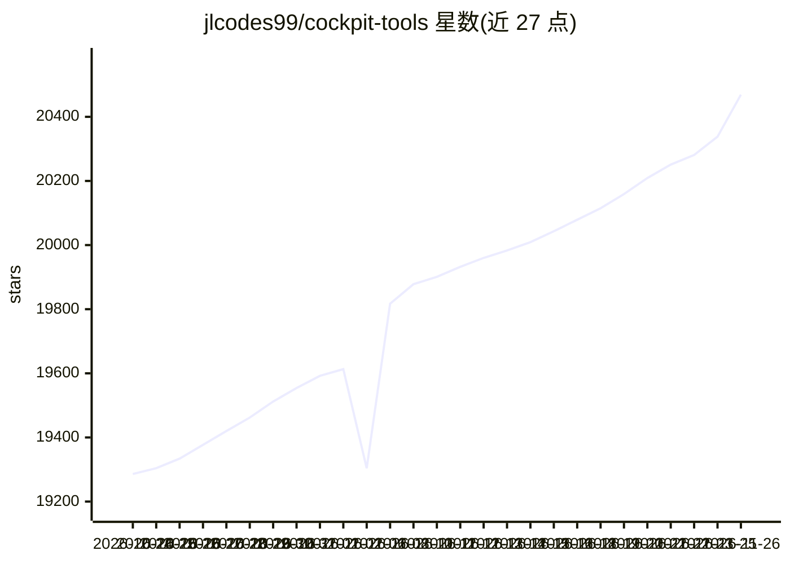

# jlcodes99/cockpit-tools

⭐ 20,469 · Rust · 推送 2026-11-25 · [GitHub](https://github.com/jlcodes99/cockpit-tools) · [官网](https://github.com/jlcodes99/cockpit-tools#readme) · 个人维护 · 中文 README

**AI IDE 多账号管理桌面工具：切号、配额监控与多开**

本地桌面工具，统一管理 17 种 AI IDE/CLI 的账号：支持 OAuth 授权、Token/JSON/本机导入、切号注入启动、配额与套餐查询、定时唤醒任务，以及多账号多实例并行运行（独立用户目录与启动参数）。内置 Rust 引擎的 API 服务为 Codex 提供 Responses/Claude/Gemini/Ollama 协议兼容的本地网关与账号池调度。数据保存在本机 ~/.cockpit_tools，不依赖自建云端。官方支持 macOS、Windows、Linux。

## 筛选速览

| 维度 | 判定 | 备注 |
|---|---|---|
| AI 角色 | `ai-ecosystem` | LLM/agent 周边工具 |
| 许可风险 | `none` | — |
| 部署形态 | `desktop` | 安装包/桌面程序 |
| 模型依赖 | local-ok | 支持本地模型 |
| 硬件要求 | — | 无带数字的原话,不猜 |
| 安装摩擦 | `low` | 无编译、无系统依赖或容器化 |
| 成熟度 | — | 结构信号不足 |

## 动量与使用信号

- 维护:`active` — 距上次 push 0.8 天,年发版 100,78 位贡献者
- 涨星:近 1 天 **+33**(自 20261016 起算)
- 平台:WINDOWS / MACOS / LINUX · 协议:MCP / OLLAMA

## 能力要点

- 17 个 AI IDE/CLI 平台的账号导入、切号注入与配额监控
- 多账号多实例并行运行，实例目录与启动参数隔离
- Rust 引擎 API 服务支持 Responses/Chat Completions/Claude/Gemini/Ollama 协议兼容
- 支持 18 种界面语言，本地存储账号数据

## 适用场景

- 在多个 AI IDE 订阅账号之间一键切换
- 同时运行多个 IDE 实例绑定不同账号处理不同项目
- 实时查看各平台模型配额余量与重置时间
- 通过本地 API 服务为 Codex 接入账号池与多种模型协议

## 场景标签

 · 领域:开发工具/AI IDE 辅助

## 证据(README 行号)

> L10: 一款**通用的 AI IDE 账号管理工具**，目前支持 **Antigravity IDE**、**Codex**、**GitHub Copilot**、**Windsurf**、**Kiro**、**Cursor**、**Gr
> L86: - **API 服务**：统一由宿主内的 Rust 引擎运行，支持 Responses HTTP/SSE/WebSocket、上下文压缩及 Chat Completions、Claude、Gemini、Ollama 协议兼容。旧 
> L283: - **这是本地桌面工具**：不需要单独注册平台账号，也不依赖项目自建云端来存你的账号列表。

## 星数曲线

2026-10-24 19,286 → 2026-11-26 20,469（+1,183）

---
*卡片 v1 · prompt 1.4 · 生成 2026-11-24 · 置信度 mid · 依据 README sha `2463aab3521c` · [字段定义](../../DATASET.md)*
