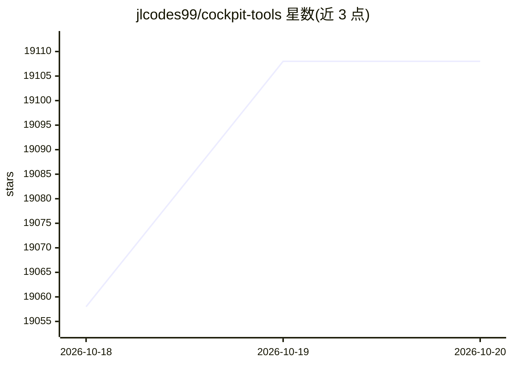

# jlcodes99/cockpit-tools

⭐ 19,108 · Rust · 推送 2026-10-19 · [GitHub](https://github.com/jlcodes99/cockpit-tools) · [官网](https://github.com/jlcodes99/cockpit-tools#readme) · 个人维护 · 中文 README

**管理多款 AI IDE/Cli 账号的桌面工具：切号、配额、多开**

本地桌面工具，统一管理 Antigravity、Codex、GitHub Copilot、Windsurf、Kiro、Cursor、Grok CLI、CodeBuddy、Qoder、Trae、Zed、ZCode 等平台的账号：一键切换、OAuth/Token 导入、配额监控、定时唤醒任务，以及各平台应用的多账号多实例并行运行。数据保存在本机目录，提供 WebSocket 本机 API 供插件联动。支持 macOS/Windows/Linux 与 18 种界面语言。Grok CLI 凭据以明文保存在本机，README 提示依赖系统文件权限保护。

## 筛选速览

| 维度 | 判定 | 备注 |
|---|---|---|
| AI 角色 | `ai-ecosystem` | LLM/agent 周边工具 |
| 许可风险 | `none` | — |
| 部署形态 | `desktop` | 安装包/桌面程序 |
| 模型依赖 | local-ok | 支持本地模型 |
| 硬件要求 | — | 无带数字的原话,不猜 |
| 安装摩擦 | `low` | 无编译、无系统依赖或容器化 |
| 成熟度 | — | 结构信号不足 |

## 动量与使用信号

- 维护:`active` — 距上次 push 0.8 天,年发版 100,78 位贡献者
- 涨星:近 1 天 **+33**(自 20261016 起算)
- 平台:WINDOWS / MACOS / LINUX · 协议:MCP / OLLAMA

## 能力要点

- 覆盖 16 个 AI IDE/CLI 平台的账号切换与配额监控
- 各平台多账号多实例并行运行与参数隔离
- 内置 Rust/Go 双引擎本地网关，提供 OpenAI 兼容等接口
- WebSocket 仅监听 127.0.0.1，提供本机切号 API

## 适用场景

- 同时持有多个 AI IDE 账号，需要在工作与个人项目间快速切换
- 监控各平台订阅配额的剩余量与重置时间
- 为不同账号启动相互隔离的多个 IDE 实例

## 场景标签

 · 领域:开发者工具/AI IDE 周边工具

## 证据(README 行号)

> L10: 一款**通用的 AI IDE 账号管理工具**，目前支持 **Antigravity IDE**、**Codex**、**GitHub Copilot**、**Windsurf**、**Kiro**、**Cursor**、**Gr
> L271: - **这是本地桌面工具**：不需要单独注册平台账号，也不依赖项目自建云端来存你的账号列表。

## 星数曲线

2026-10-18 19,058 → 2026-10-20 19,108（+50）

---
*卡片 v1 · prompt 1.4 · 生成 2026-10-18 · 置信度 mid · 依据 README sha `ae1874da883d` · [字段定义](../../DATASET.md)*
