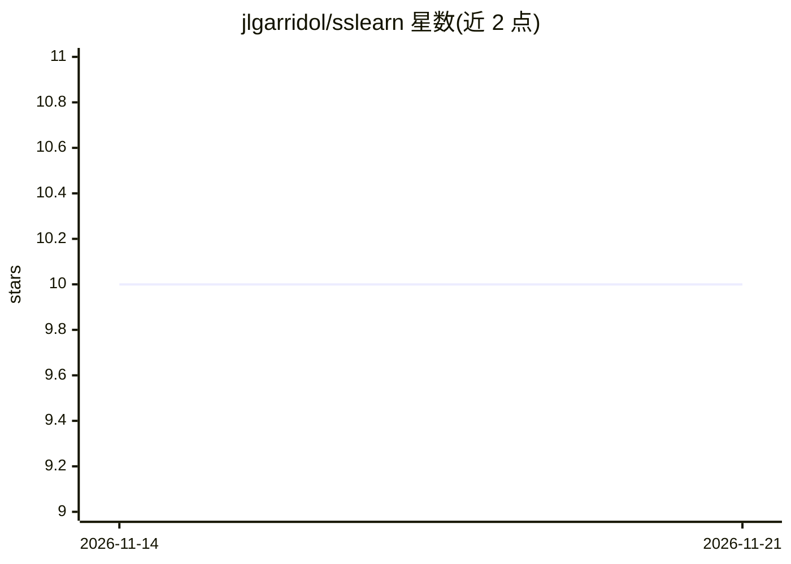

# jlgarridol/sslearn

⭐ 10 · Python · BSD-3-Clause · 推送 2026-11-11 · [GitHub](https://github.com/jlgarridol/sslearn) · [官网](https://jlgarridol.github.io/sslearn/) · 个人维护

**scikit-learn 扩展的 Python 半监督学习库**

sslearn 是一个 Python 包，面向半监督数据集提供机器学习功能，是 scikit-learn 的扩展。提供 pip 安装，依赖 joblib、numpy、pandas、scikit-learn、scipy、statsmodels 等科学计算库，pytest 仅用于测试。项目附有 SoftwareX 期刊引用条目（BibTeX 格式），开发获得西班牙卡斯蒂利亚-莱昂自治区政府与西班牙科学创新部的科研经费资助，README 未展示算法清单与使用示例。

## 筛选速览

| 维度 | 判定 | 备注 |
|---|---|---|
| AI 角色 | `ai-native` | 本体是模型或模型工具 |
| 许可风险 | `permissive` | BSD-3-Clause |
| 部署形态 | `library` | 以包/库形式分发 |
| 模型依赖 | — | README 未给出锁定关系 |
| 硬件要求 | — | 无带数字的原话,不猜 |
| 安装摩擦 | `low` | 无编译、无系统依赖或容器化 |
| 成熟度 | — | 结构信号不足 |

## 能力要点

- scikit-learn 扩展的 Python 半监督学习库
- 通过 PyPI 提供 pip install sslearn 安装
- 提供 BibTeX 引用条目（SoftwareX 期刊）

## 适用场景

- 在少量标注、大量未标注数据上训练分类模型
- 沿用 scikit-learn API 风格做半监督学习实验

## 场景标签

 · 领域:机器学习/半监督学习

## 证据(README 行号)

> L6: The `sslearn` library is a Python package for machine learning over Semi-supervised datasets. It is an extension of 
> L30:     title = {SSLearn: A Semi-Supervised Learning library for Python},

## 星数曲线

2026-11-14 10 → 2026-11-21 10（+0）

---
*卡片 v1 · prompt 1.4 · 生成 2026-11-19 · 置信度 high · 依据 README sha `b29583ca1b46` · [字段定义](../../DATASET.md)*
