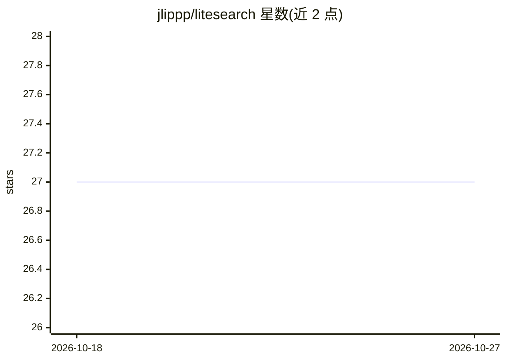

# jlippp/litesearch

⭐ 27 · Python · 推送 2026-03-22 · [GitHub](https://github.com/jlippp/litesearch) · 个人维护

**给消费级 NVIDIA GPU 的自主 LLM 训练实验台（autoresearch 分支）**

autoresearch 的分支，面向 2GB–32GB+ VRAM 的消费级 NVIDIA GPU：让 AI agent 在真实的小型 LLM 训练环境中自主循环实验（改代码、训练 5 分钟、检查结果、保留或丢弃），并新增 CustomTkinter GUI 仪表盘（实时日志、VRAM 条、配置滑块）、按 VRAM 预算自动缩放模型结构、.pth 模型导出、文本生成试聊与断点续训。以 fp32 回退支持 Pascal 架构 GPU，使用 PyTorch 内置注意力实现，去除自定义 CUDA 核依赖。要求单张 NVIDIA GPU 与 Python 3.10+。

## 筛选速览

| 维度 | 判定 | 备注 |
|---|---|---|
| AI 角色 | `ai-ecosystem` | LLM/agent 周边工具 |
| 许可风险 | `none` | — |
| 部署形态 | `None` |  |
| 模型依赖 | — | README 未给出锁定关系 |
| 硬件要求 | — | 无带数字的原话,不猜 |
| 安装摩擦 | `medium` | 含编译或系统依赖之一 |
| 成熟度 | — | 结构信号不足 |

## 能力要点

- 支持 GTX 970 至 RTX 4090+（2GB–32GB+ VRAM），Pascal 卡自动 fp32 回退
- 按 VRAM 预算自动计算模型深度/批大小/序列长度，恒开梯度检查点
- CustomTkinter GUI：实时训练日志、VRAM 滑块、导出调度、Try 文本生成（temperature/top-p）
- 训练模型可导出为 .pth，支持从当前模型继续训练

## 适用场景

- 让 AI agent 在消费级 GPU 上过夜自主跑小型 LLM 训练实验
- VRAM 受限的旧显卡（如 GTX 1080 Ti）上跑小模型训练并试生成文本
- 查看实验日志并导出/续训产出的模型

## 场景标签

`模型训练` · 领域:训练与推理

## 证据(README 行号)

> L7: The idea: give an AI agent a small but real LLM training setup and let it experiment autonomously overnight. It modi
> L97: train.py        — model, optimizer, training loop, VRAM auto-config (agent modifies this)

## 星数曲线

2026-10-18 27 → 2026-10-27 27（+0）

---
*卡片 v1 · prompt 1.4 · 生成 2026-10-26 · 置信度 high · 依据 README sha `afa143d06be2` · [字段定义](../../DATASET.md)*
