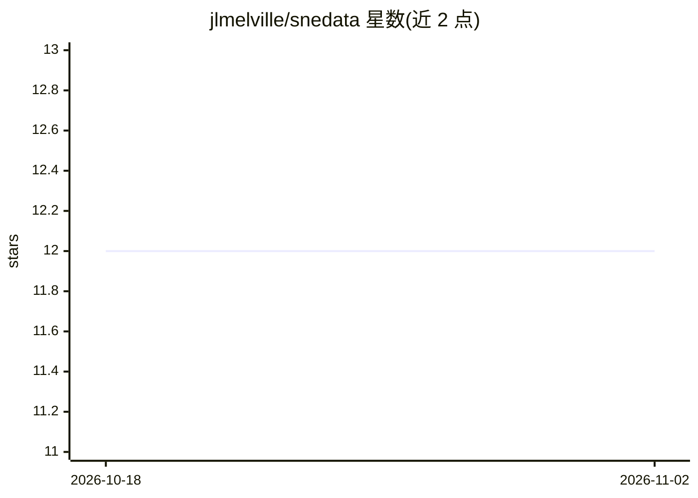

# jlmelville/snedata

⭐ 12 · R · NOASSERTION · 推送 2026-11-01 · [GitHub](https://github.com/jlmelville/snedata) · [官网](http://jlmelville.github.io/snedata/) · 个人维护

**R 包：生成/获取降维方法用的模拟与经典数据集**

面向使用 t-SNE 等降维方法的研究者与开发者，snedata 提供 R 函数生成简单模拟数据集，并包含 How to use t-SNE Effectively 文章所用数据集、Frey/Olivetti 人脸辅助函数、MNIST 类数据集、CIFAR-10、Small NORB、猛犸象点云、20 Newsgroups、COIL、历史 Isomap 数据集等降维论文常用示例。通过 pak 从 GitHub 安装，MIT 许可，附带 pkgdown 站点文档。

## 筛选速览

| 维度 | 判定 | 备注 |
|---|---|---|
| AI 角色 | `ai-knowledge` | 知识聚合/清单类 |
| 许可风险 | `none` | NOASSERTION |
| 部署形态 | `None` |  |
| 模型依赖 | — | README 未给出锁定关系 |
| 硬件要求 | — | 无带数字的原话,不猜 |
| 安装摩擦 | `low` | 无编译、无系统依赖或容器化 |
| 成熟度 | — | 结构信号不足 |

## 能力要点

- 生成 SNE/降维研究用模拟数据集的函数集合
- 收录 t-SNE 降维论文常用的经典数据集（MNIST 类、CIFAR-10、Isomap 等）
- 提供 pkgdown 站点数据集总表与示例

## 适用场景

- t-SNE 等降维算法实验需要基准数据集
- 复现降维论文中的示例数据
- 生成球面、高斯等模拟点云测试嵌入效果

## 场景标签

 · 领域:机器学习/降维

## 证据(README 行号)

> L8: This package provides functions for generating simple simulation datasets for use in Stochastic
> L14: The package includes simulation datasets, the datasets from

## 星数曲线

2026-10-18 12 → 2026-11-02 12（+0）

---
*卡片 v1 · prompt 1.4 · 生成 2026-11-01 · 置信度 high · 依据 README sha `4823613254ad` · [字段定义](../../DATASET.md)*
