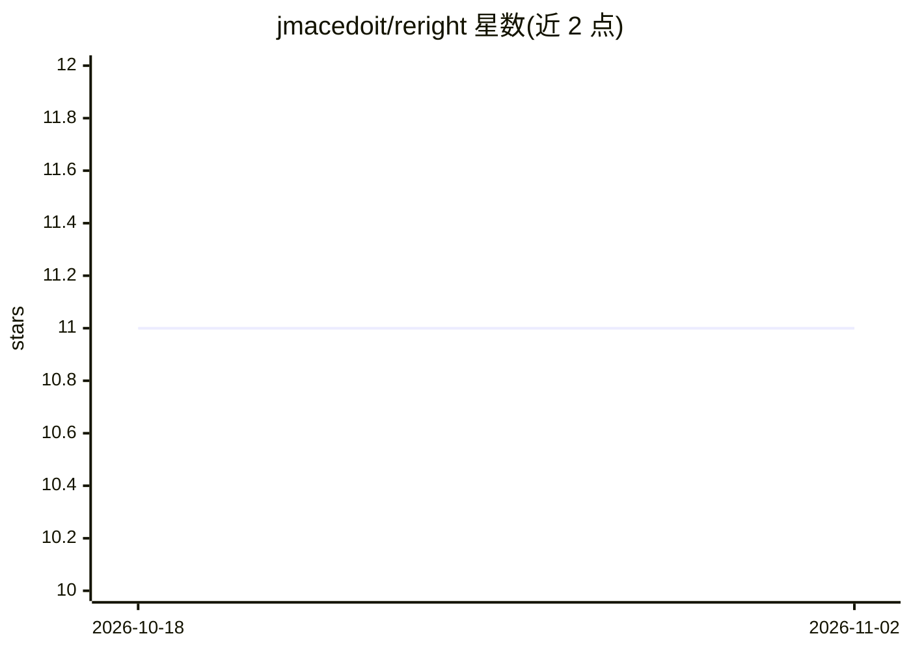

# jmacedoit/reright

⭐ 11 · TypeScript · NOASSERTION · 推送 2026-05-06 · [GitHub](https://github.com/jmacedoit/reright) · 个人维护

**系统托盘剪贴板 AI 文本改写工具，全局快捷键即时改写**

基于 Tauri 的桌面常驻应用，驻留系统托盘，通过全局快捷键或托盘菜单将剪贴板/选中文本发送给 AI 改写后粘回原处，覆盖快速改写、/// 命令词指定改写与一次性自定义指令三种模式，支持自定义改写命令。用户自带 OpenAI、Anthropic 或 Gemini API key，按用量付费。提供 macOS/Windows/Linux 安装包，macOS 与 Windows 支持免复制的 ergonomic 模式。许可证为 Source-Available Non-Commercial。

## 筛选速览

| 维度 | 判定 | 备注 |
|---|---|---|
| AI 角色 | `ai-native` | 本体是模型或模型工具 |
| 许可风险 | `none` | NOASSERTION |
| 部署形态 | `desktop` | 安装包/桌面程序 |
| 模型依赖 | locked-api |  |
| 硬件要求 | — | 无带数字的原话,不猜 |
| 安装摩擦 | `low` | 无编译、无系统依赖或容器化 |
| 成熟度 | — | 结构信号不足 |

## 能力要点

- 三种改写模式：默认命令、///命令词、一次性自定义指令
- 支持 OpenAI、Anthropic（Claude）、Google（Gemini）自带 API key
- 系统托盘集成与全局快捷键，无需离开当前应用
- 基于 Tauri 构建，macOS/Windows/Linux 均有安装包

## 适用场景

- 在 Slack/邮件中快速修正错别字或调整语气
- 在终端/代码场景用描述生成 shell 命令、SQL、正则
- 在 Figma/Notion 中生成微文案、整理思路、翻译润色

## 场景标签

`AI 写作` · 领域:内容生成

## 证据(README 行号)

> L5:  Transform your text with AI, right from your clipboard.
> L46: Reright helps you transform text using AI-powered rewrites. Copy any text, trigger a rewrite, and paste the result.
> L114: - 🤖 **Multiple AI providers**: Works with OpenAI, Anthropic (Claude), and Google (Gemini)

## 星数曲线

2026-10-18 11 → 2026-11-02 11（+0）

---
*卡片 v1 · prompt 1.4 · 生成 2026-11-02 · 置信度 high · 依据 README sha `94212042a69c` · [字段定义](../../DATASET.md)*
