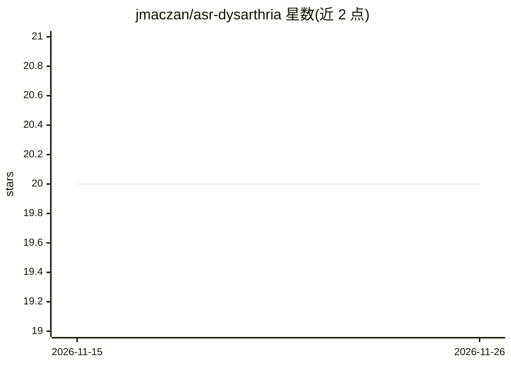

# jmaczan/asr-dysarthria

⭐ 20 · Jupyter Notebook · 推送 2026-11-15 · [GitHub](https://github.com/jmaczan/asr-dysarthria) · [官网](https://huggingface.co/jmaczan/wav2vec2-large-xls-r-300m-dysarthria) · 个人维护

**针对构音障碍语音的 wav2vec2 语音识别研究与训练代码**

面向构音障碍（dysarthria）人群的自动语音识别研究仓库：基于 wav2vec2-large-xls-r-300m 微调，提供训练用 Jupyter Notebook、CLI 推理脚本（支持 safetensors 与 ONNX 两种格式）、模型转换与 Web 部署脚本，以及两个在 TORGO/UASpeech 数据集上训练的 Hugging Face 预训练模型（WER 约 0.18）。README 自述处于重度研发阶段、文档可能过时；需 Python>=3.10 与 Anaconda，通过 conda 安装依赖。作者另提供浏览器在线试用页面。

## 筛选速览

| 维度 | 判定 | 备注 |
|---|---|---|
| AI 角色 | `ai-native` | 本体是模型或模型工具 |
| 许可风险 | `none` | — |
| 部署形态 | `None` |  |
| 模型依赖 | — | README 未给出锁定关系 |
| 硬件要求 | — | 无带数字的原话,不猜 |
| 安装摩擦 | `low` | 无编译、无系统依赖或容器化 |
| 成熟度 | `idea` | |

## 能力要点

- 基于 wav2vec2-large-xls-r-300m 的构音障碍语音微调流程（Jupyter Notebook）
- CLI 推理支持 safetensors 与 ONNX 两种格式
- 两个 Hugging Face 预训练模型（最低 WER 0.1764）
- 提供模型转换脚本与浏览器 Web 部署路径

## 适用场景

- 我要微调或复现针对构音障碍语音的 ASR 模型
- 我想在本地对构音障碍者的录音做文字转写
- 我想在浏览器中试用构音障碍语音识别模型

## 场景标签

`语音识别` `微调` · 领域:感知与多模态

## 证据(README 行号)

> L3: Automatic speech recognition for people with dysarthria
> L11: Use this Jupyter Notebook wav2vec2-large-xls-r-300m-dysarthria-big-dataset.ipynb to train your own model
> L28: Run model.safetensors: `python -m run`

## 星数曲线

2026-11-15 20 → 2026-11-26 20（+0）

---
*卡片 v1 · prompt 1.4 · 生成 2026-11-18 · 置信度 high · 依据 README sha `c0864140915c` · [字段定义](../../DATASET.md)*
