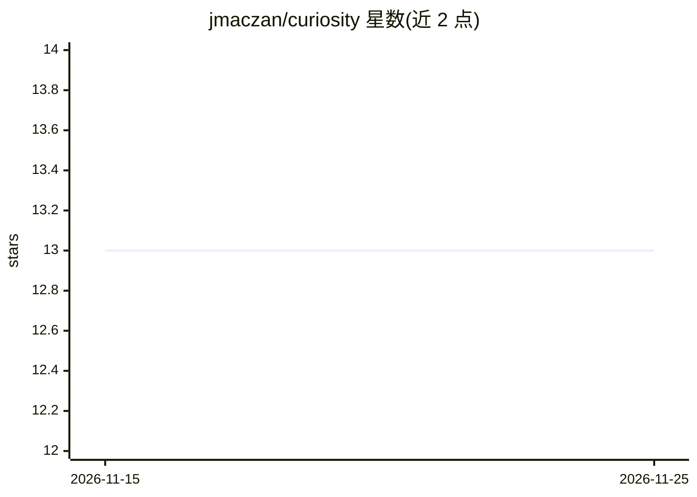

# jmaczan/curiosity

⭐ 13 · C · 推送 2026-11-15 · [GitHub](https://github.com/jmaczan/curiosity) · 个人维护

**从零实现底层深度学习概念的 C 语言学习项目**

以 C 语言从零实现张量、自动微分（autograd）与多层感知机（MLP）等底层深度学习概念的项目，README 标注与 tinygrad 相关的 low-level 主题。通过仓库内的 run 脚本以 ./run <filename> <gcc|clang> <train|run> 方式编译并运行张量与 MLP 程序，支持训练（train）与推理（run）两种模式，面向希望从底层理解深度学习机制的学习者与开发者。

## 筛选速览

| 维度 | 判定 | 备注 |
|---|---|---|
| AI 角色 | `ai-native` | 本体是模型或模型工具 |
| 许可风险 | `none` | — |
| 部署形态 | `None` |  |
| 模型依赖 | — | README 未给出锁定关系 |
| 硬件要求 | — | 无带数字的原话,不猜 |
| 安装摩擦 | `low` | 无编译、无系统依赖或容器化 |
| 成熟度 | — | 结构信号不足 |

## 能力要点

- 提供 tensor 与 mlp 两类可运行示例
- 通过 run 脚本以 gcc/clang 编译并区分 train/run 模式
- 主题覆盖 autograd、tensor、neural-network、low-level

## 适用场景

- 从底层理解张量与自动微分的实现机制
- 用 C 语言亲手实现并训练多层感知机

## 场景标签

`模型训练` `教程课程` · 领域:学习与行业

## 证据(README 行号)

> L3: ./run <filename> <gcc|clang> <train|run>
> L5:       - mlp

## 星数曲线

2026-11-15 13 → 2026-11-25 13（+0）

---
*卡片 v1 · prompt 1.4 · 生成 2026-11-18 · 置信度 low · 依据 README sha `31d3375f592b` · [字段定义](../../DATASET.md)*
