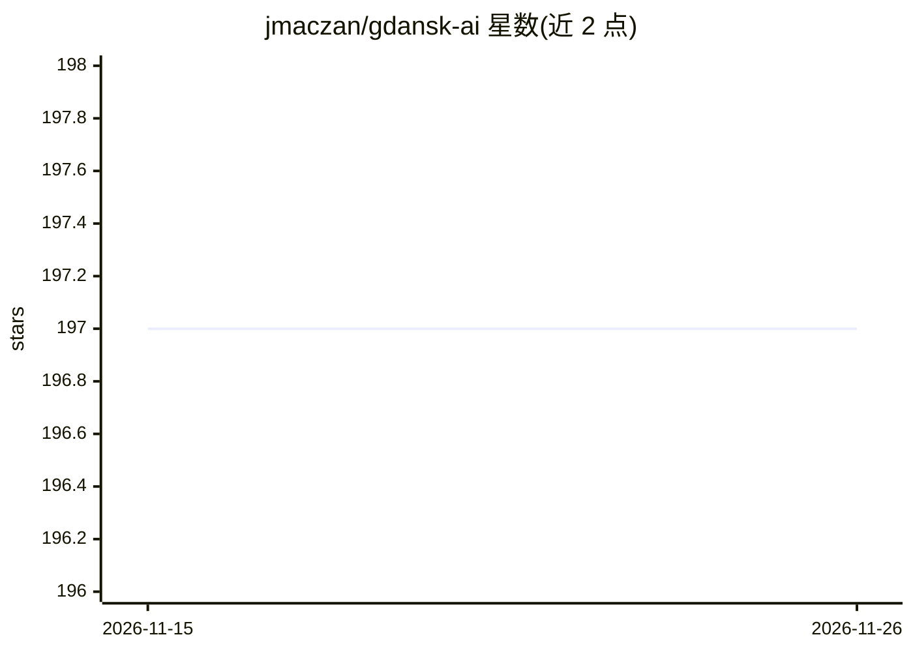

# jmaczan/gdansk-ai

⭐ 197 · TypeScript · GPL-2.0 · 推送 2026-11-15 · [GitHub](https://github.com/jmaczan/gdansk-ai) · [官网](https://news.ycombinator.com/item?id=37004708) · 个人维护

**全栈语音聊天机器人：语音转文本、LLM、语音合成**

由 Web 前端（Next.js）、Web API（Node.js/TypeScript/Express）与 AI API（Python/FastAPI）组成的全栈语音聊天应用：用户录音发送，经 Whisper-1 转文本、gpt-3.5-turbo 生成回答、Google Cloud TextToSpeechClient 合成语音后播放。集成 Auth0 认证（免费层每月 7000 用户）与 Stripe 支付购买名为 bibs 的 API 令牌。需自行配置 OpenAI 与 Google Cloud 账号及 API key，前端当前仅在 Google Chrome 下工作。GPL v2 许可。

## 筛选速览

| 维度 | 判定 | 备注 |
|---|---|---|
| AI 角色 | `ai-native` | 本体是模型或模型工具 |
| 许可风险 | `viral` | GPL-2.0 |
| 部署形态 | `library` | 以包/库形式分发 |
| 模型依赖 | — | README 未给出锁定关系 |
| 硬件要求 | — | 无带数字的原话,不猜 |
| 安装摩擦 | `low` | 无编译、无系统依赖或容器化 |
| 成熟度 | — | 结构信号不足 |

## 能力要点

- 三部分架构：Next.js Web、Express Web API、FastAPI AI API
- 语音链路：Whisper-1 转文本 + gpt-3.5-turbo + Google Cloud TTS
- Auth0 认证与 Stripe 按次购买 API 令牌（bibs）

## 适用场景

- 搭建带登录和付费的语音对话 Web 应用
- 学习全栈 AI 语音聊天应用的集成方式
- 作为 OpenAI 与 Google Cloud API 组合调用的参考实现

## 场景标签

`语音 Agent` · 领域:对话与助手

## 证据(README 行号)

> L3: Gdańsk AI is a full stack AI voice chatbot (speech-to-text, LLM, text-to-speech) with integrations to Auth0, OpenAI,
> L65: OpenAI and Google Cloud API are used here to provide speech-to-text (Whisper-1), LLM (gpt-3.5-turbo) and text-to-sp

## 星数曲线

2026-11-15 197 → 2026-11-26 197（+0）

---
*卡片 v1 · prompt 1.4 · 生成 2026-11-17 · 置信度 high · 依据 README sha `504c37e820fa` · [字段定义](../../DATASET.md)*
