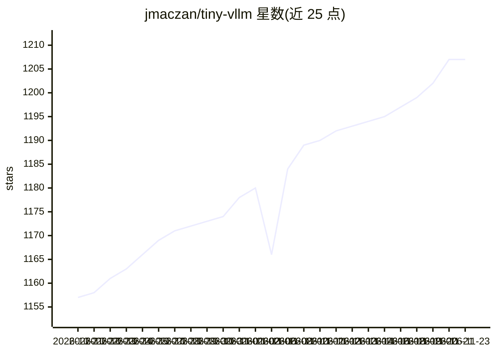

# jmaczan/tiny-vllm

⭐ 1,207 · C++ · Apache-2.0 · 推送 2026-11-15 · [GitHub](https://github.com/jmaczan/tiny-vllm) · 个人维护

**教你用 C++/CUDA 从零实现 LLM 推理引擎的课程+源码**

仓库由两部分组成：完整的推理服务器源码（C++/CUDA 实现）与配套教学课程，作者引导学习者从零推导实现思路。引擎功能包括加载 Safetensors 权重（Llama 3.2 1B Instruct）、完整前向过程（prefill+decode）、KV cache、静态与连续批处理、FlashAttention-like softmax 与 PagedAttention。面向高技术水平的读者与讲师，可作学习或教学资源；训练与模型设计不在课程范围内，需 NVIDIA GPU（AMD GPU 可经 ROCm/HIP 构建）。

## 筛选速览

| 维度 | 判定 | 备注 |
|---|---|---|
| AI 角色 | `ai-ecosystem` | LLM/agent 周边工具 |
| 许可风险 | `permissive` | Apache-2.0 |
| 部署形态 | `None` |  |
| 模型依赖 | — | README 未给出锁定关系 |
| 硬件要求 | — | 无带数字的原话,不猜 |
| 安装摩擦 | `high` | 编译与系统依赖俱全 |
| 成熟度 | — | 结构信号不足 |

## 能力要点

- CUDA 内核实现全部计算，含 KV cache 与连续批处理
- 实现 PagedAttention 与 FlashAttention-like 机制
- 读取 Safetensors 格式模型权重（Llama 3.2 1B Instruct）
- 支持 AMD GPU：通过 ROCm/HIP 构建路径复用 CUDA 源码

## 适用场景

- 学习 LLM 推理引擎内部实现与 CUDA 编程
- 讲师将引擎实现过程用作高校教学资源
- 理解 PagedAttention、连续批处理等推理机制的工程实现

## 场景标签

`教程课程` `推理引擎` · 领域:学习与行业

## 证据(README 行号)

> L7: This repository consists of two things: 1. a full source code of the inference server and 2. a course where I lead y
> L47: 3. **Serve the model (we are here)** - The file with weights can't be ran on a computer. It's not an executable. It
> L53: > Out of scope: The training phase of an LLM is something we don't do in this course. We take a trained LLM and wri

## 星数曲线

2026-10-21 1,157 → 2026-11-23 1,207（+50）

---
*卡片 v1 · prompt 1.4 · 生成 2026-11-23 · 置信度 high · 依据 README sha `a67ab3adf818` · [字段定义](../../DATASET.md)*
