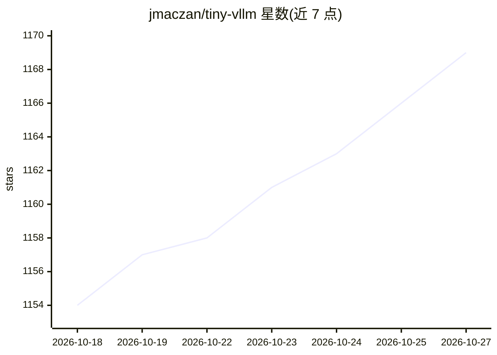

# jmaczan/tiny-vllm

⭐ 1,169 · C++ · Apache-2.0 · 推送 2026-10-22 · [GitHub](https://github.com/jmaczan/tiny-vllm) · 个人维护

**用 C++/CUDA 从零实现 LLM 推理引擎的教学课程与源码**

包含两部分：一个可构建运行的推理服务器完整源码，以及带领读者从零推导并实现引擎的课程。引擎从 Safetensors 加载 Llama 3.2 1B Instruct，实现 prefill+decode 前向、KV cache、静态/连续批处理、online softmax（FlashAttention 风格）与 PagedAttention，全部计算用 CUDA kernel。需 NVIDIA GPU 自行编译（./test.sh），也支持经 ROCm/HIP 在 AMD GPU 上构建。面向学习者与高校教学，不做模型训练。

## 筛选速览

| 维度 | 判定 | 备注 |
|---|---|---|
| AI 角色 | `ai-ecosystem` | LLM/agent 周边工具 |
| 许可风险 | `permissive` | Apache-2.0 |
| 部署形态 | `None` |  |
| 模型依赖 | — | README 未给出锁定关系 |
| 硬件要求 | — | 无带数字的原话,不猜 |
| 安装摩擦 | `high` | 编译与系统依赖俱全 |
| 成熟度 | — | 结构信号不足 |

## 能力要点

- Safetensors 加载 Llama 3.2 1B Instruct 并实现完整前向（prefill+decode）
- KV cache、静态/连续批处理、online softmax、PagedAttention
- 全部计算以 CUDA kernel 实现，cuBLAS 辅助
- 支持经 ROCm/HIP 在 AMD GPU（gfx90a/gfx1100/gfx1201）构建

## 适用场景

- 学习 LLM 推理引擎内部原理并亲手实现
- 高校课程的教学资源
- 理解 PagedAttention、连续批处理等推理优化机制

## 场景标签

`教程课程` `推理引擎` · 领域:学习与行业

## 证据(README 行号)

> L3: You're going to build a high performance LLM inference engine with C++ and CUDA - tiny-vllm, a younger and smaller s
> L9: The inference engine consists of:
> L16: - [x] continuous batching

## 星数曲线

2026-10-18 1,154 → 2026-10-27 1,169（+15）

---
*卡片 v1 · prompt 1.4 · 生成 2026-10-21 · 置信度 high · 依据 README sha `11ee2c2fc482` · [字段定义](../../DATASET.md)*
