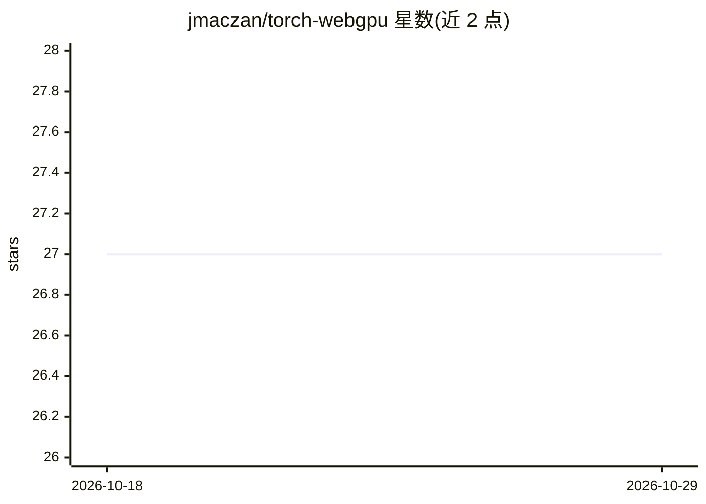

# jmaczan/torch-webgpu

⭐ 27 · C++ · Apache-2.0 · 推送 2026-04-14 · [GitHub](https://github.com/jmaczan/torch-webgpu) · [官网](https://torch-webgpu.maczan.pl) · 个人维护

**PyTorch 的 WebGPU 编译器与运行时后端，可运行 LLM**

基于 PyTorch PrivateUse1 机制实现的 WebGPU 后端：提供 webgpu_backend 编译后端与 device="webgpu" 设备，使用 @torch.compile 将 PyTorch 程序编译到 WebGPU 运行，底层使用 Google Dawn，可编译运行 Llama 3.2 3B 级模型。通过 pip 安装，支持 Linux x86_64、Apple Silicon macOS 与 Windows x86_64。限制：仅支持 float32、部分算子回退 CPU、性能尚未优化，CPU<->WebGPU 之外的设备互转（CUDA/MPS 等）未实现。项目声明 1.0.0 后目标生产可用。

## 筛选速览

| 维度 | 判定 | 备注 |
|---|---|---|
| AI 角色 | `ai-ecosystem` | LLM/agent 周边工具 |
| 许可风险 | `permissive` | Apache-2.0 |
| 部署形态 | `library` | 以包/库形式分发 |
| 模型依赖 | — | README 未给出锁定关系 |
| 硬件要求 | — | 无带数字的原话,不猜 |
| 安装摩擦 | `medium` | 含编译或系统依赖之一 |
| 成熟度 | `idea` | |

## 能力要点

- PyTorch compile 后端 + webgpu 设备，编译运行到真实 WebGPU
- 底层基于 Google Dawn，含 WGSL shader 生成
- 可在 WebGPU 上编译运行 LLM（如 Llama 3.2 3B）
- 跨 Linux/macOS(Apple Silicon)/Windows 三平台

## 适用场景

- 在没有 CUDA 的硬件上用 PyTorch 运行模型
- 探索 PyTorch 程序在浏览器/WebGPU 环境运行
- 学习 ML 编译器与 PyTorch 自定义后端机制

## 场景标签

`推理引擎` · 领域:训练与推理

## 证据(README 行号)

> L3: **PyTorch compiler and WebGPU runtime, capable of running LLMs like LLama 3.2 3B**
> L37: And now you can use `@torch.compile(backend=webgpu_backend)`, `device="webgpu"`, `to="webgpu"` to run and compile P

## 星数曲线

2026-10-18 27 → 2026-10-29 27（+0）

---
*卡片 v1 · prompt 1.4 · 生成 2026-10-26 · 置信度 high · 依据 README sha `a449157a1447` · [字段定义](../../DATASET.md)*
