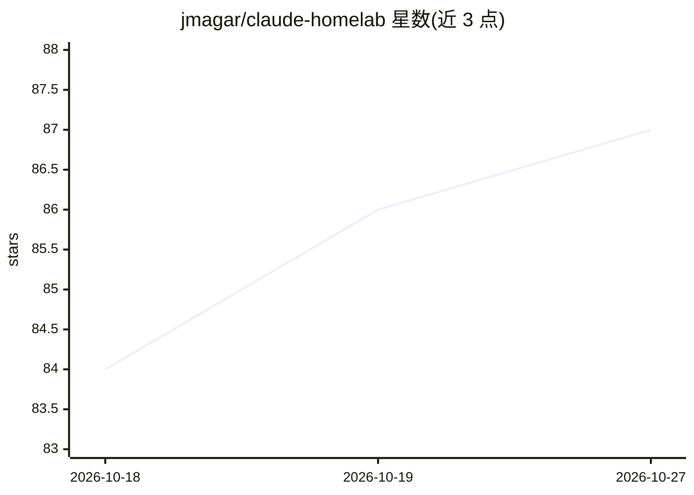

# jmagar/claude-homelab

⭐ 87 · Shell · MIT · 推送 2026-09-30 · [GitHub](https://github.com/jmagar/claude-homelab) · 个人维护

**面向家庭实验室的 Claude Code/Codex/Gemini 插件与技能仓库**

homelab-core 插件的 monorepo，以 Claude Code 插件形式（并镜像到 Codex 与 Gemini 扩展清单）提供家庭实验室服务管理能力：16 个捆绑技能型服务集成，覆盖媒体自动化（Plex/Radarr/Sonarr）、基础设施监控（Docker/ZFS/UniFi/Unraid）、文档管理（Paperless-ngx/Linkding/NotebookLM）等。所有凭据集中于单一 ~/.claude-homelab/.env 文件（chmod 600），通过安装脚本符号链接到 ~/.claude/。提供 Claude 市场安装与 Bash 安装脚本两种途径，依赖 git/jq/curl。

## 筛选速览

| 维度 | 判定 | 备注 |
|---|---|---|
| AI 角色 | `ai-ecosystem` | LLM/agent 周边工具 |
| 许可风险 | `permissive` | MIT |
| 部署形态 | `self-host` | docker 或自建部署 |
| 模型依赖 | locked-api |  |
| 硬件要求 | — | 无带数字的原话,不猜 |
| 安装摩擦 | `low` | 无编译、无系统依赖或容器化 |
| 成熟度 | — | 结构信号不足 |

## 能力要点

- homelab-core 插件通过 Claude 市场发布，镜像到 Codex 与 Gemini
- 16 个捆绑技能型服务集成（媒体/基础设施/文档管理）
- 单文件凭据模型（.env + chmod 600 + load-env.sh 校验）
- 系统资源、Docker 健康、磁盘、ZFS 等审计命令

## 适用场景

- 用 Claude Code 管理家庭实验室的媒体下载与自动化服务
- 审计 Docker 容器、ZFS 存储池与磁盘空间健康状况
- 通过 NotebookLM 命令创建笔记本并生成播客、测验等产物
- 统一配置各 homelab 服务的 API 凭据

## 场景标签

`工作流自动化` · 领域:效率与自动化

## 证据(README 行号)

> L5: Homelab plugin hub for Claude Code, Codex, and Gemini. This repository is the source of truth for the `homelab-core`
> L11: - The `homelab-core` plugin published through the Claude marketplace

## 星数曲线

2026-10-18 84 → 2026-10-27 87（+3）

---
*卡片 v1 · prompt 1.4 · 生成 2026-10-24 · 置信度 mid · 依据 README sha `640b0918e6ff` · [字段定义](../../DATASET.md)*
