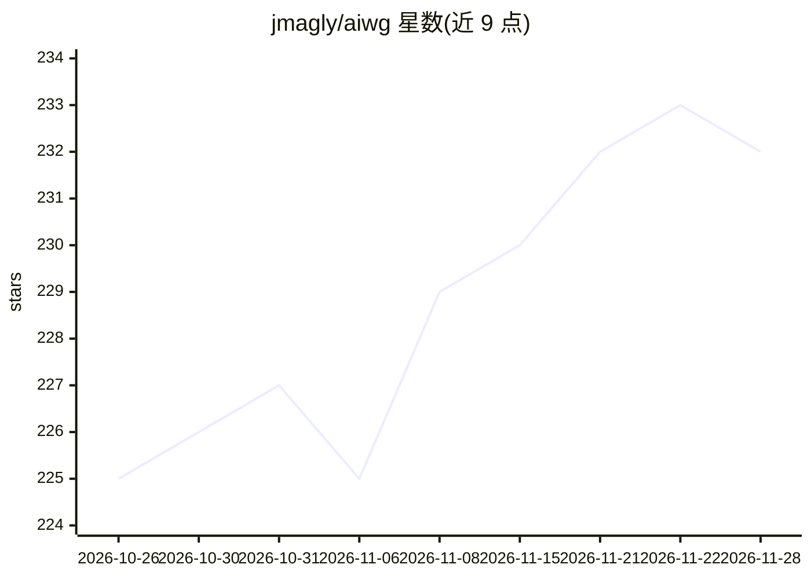

# jmagly/aiwg

⭐ 232 · TypeScript · MIT · 推送 2026-11-27 · [GitHub](https://github.com/jmagly/aiwg) · [官网](https://aiwg.io) · 组织维护

**为现有 AI 编码工具提供可复用项目上下文与专家工作流的框架**

AIWG 以 agents、skills、rules、templates、MCP 工具等形式为 Claude Code、Codex、Copilot、Cursor 等 19 个已命名的 AI 工具集成提供统一的项目上下文与 SDLC 工作流，通过 `aiwg use` 将 Markdown/YAML 源文件部署到各工具读取的路径，实现单一来源跨工具复用。支持项目级/用户级/全局三种部署范围、`.aiwg/` 持久化工件记忆、后台编排与成本遥测等可选能力，以及将受限 LLM 决策卸载以节省 token 的 Jev 决策支持（需显式 opt-in）。经 npm 全局安装，MIT 许可。

## 筛选速览

| 维度 | 判定 | 备注 |
|---|---|---|
| AI 角色 | `ai-ecosystem` | LLM/agent 周边工具 |
| 许可风险 | `permissive` | MIT |
| 部署形态 | `library` | 以包/库形式分发 |
| 模型依赖 | — | README 未给出锁定关系 |
| 硬件要求 | — | 无带数字的原话,不猜 |
| 安装摩擦 | `low` | 无编译、无系统依赖或容器化 |
| 成熟度 | — | 结构信号不足 |

## 能力要点

- 单一 Markdown/YAML 源部署到 19 个命名的 provider 集成路径
- agents/skills/commands/rules/behaviors/templates 六类构建块
- 项目/用户/全局三种部署范围与 `.aiwg/` 工件记忆
- 可选 Agentic Sandbox 隔离执行器（Docker 或 KVM/libvirt）

## 适用场景

- 为多 AI 编码工具维护一份共享的项目规则与工作流
- 组织需求分析、安全评审、测试架构等多角色协同评审
- 跨会话保存并复用架构决策与验收标准工件
- 为长时间运行的 agent 搭建自托管的隔离沙箱执行器

## 场景标签

`编码 Agent` `多智能体` `提示工程` `工作流自动化` · 领域:Agent 开发

## 证据(README 行号)

> L6: **Reusable project context and specialist workflows for the AI tools you already use.**
> L163: AIWG gives your AI assistant reusable project context and specialist workflows. Its deployment layer connects thos
> L164: instructions to your provider: `aiwg use` copies markdown and YAML source files into the paths each provider reads
> L165: one source of truth works across 19 named provider integrations. A twentieth `generic` adapter emits portable file

## 星数曲线

2026-10-26 225 → 2026-11-28 232（+7）

---
*卡片 v1 · prompt 1.4 · 生成 2026-11-27 · 置信度 high · 依据 README sha `68ecffa3fce1` · [字段定义](../../DATASET.md)*
