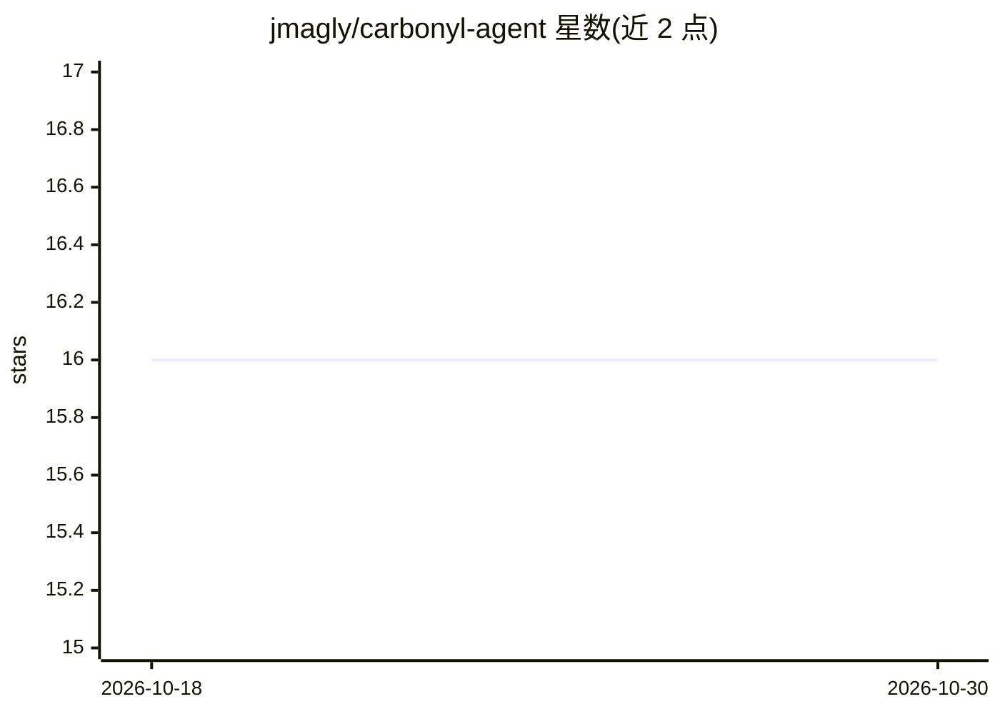

# jmagly/carbonyl-agent

⭐ 16 · Python · AGPL-3.0 · 推送 2026-07-31 · [GitHub](https://github.com/jmagly/carbonyl-agent) · [官网](https://github.com/jmagly/carbonyl-agent) · 个人维护

**Carbonyl 终端浏览器 Python 自动化 SDK，面向 LLM 代理网页交互**

面向 Carbonyl（渲染为终端文本的 Chromium 无头浏览器）的 Python SDK：通过 PTY 启动浏览器进程、用 pyte 解析屏幕文本，暴露导航、点击、文本提取等高层 API。提供命名持久会话（cookies/localStorage/IndexedDB 跨重启保留，支持 fork/snapshot/restore）、daemon 模式（Unix socket 长驻浏览器供短脚本复用）、屏幕文本检查、浏览器指纹伪装与主机浏览器 cookie 导入。返回终端文本而非 DOM，面向 LLM 驱动的浏览循环与抓取场景，定位为 Selenium/Playwright 的轻量替代。需 Python 3.11+，Linux 或 macOS。

## 筛选速览

| 维度 | 判定 | 备注 |
|---|---|---|
| AI 角色 | `ai-ecosystem` | LLM/agent 周边工具 |
| 许可风险 | `viral` | AGPL-3.0 |
| 部署形态 | `self-host` | docker 或自建部署 |
| 模型依赖 | — | README 未给出锁定关系 |
| 硬件要求 | — | 无带数字的原话,不猜 |
| 安装摩擦 | `low` | 无编译、无系统依赖或容器化 |
| 成熟度 | — | 结构信号不足 |

## 能力要点

- PTY 启动 Carbonyl 并以 pyte 解析屏幕文本，返回终端文本而非 DOM
- 命名持久会话：create/fork/snapshot/restore，跨重启保留登录态
- daemon 模式：Unix socket 长驻浏览器，客户端可重连不失状态
- 指纹伪装与主机浏览器（Chrome/Firefox 等）cookie 导入（带域级授权与审计日志）

## 适用场景

- 让 LLM 代理以纯文本形式读取网页并执行点击、表单等操作
- 在无 X11/Wayland 的服务器或容器中运行真实 Chromium 做抓取
- 复用登录态进行多会话并行抓取（fork/snapshot）
- 把主机浏览器的已登录 cookie 导入无头会话绕过脆弱登录流程

## 场景标签

`浏览器自动化` `网页抓取` · 领域:效率与自动化

## 证据(README 行号)

> L28: `carbonyl-agent` is the Python automation SDK for Carbonyl — a Chromium-based headless browser that renders into te
> L40: **Rendered text is the native LLM format.** An LLM consuming `page_text()` gets the page as a human would read it i

## 星数曲线

2026-10-18 16 → 2026-10-30 16（+0）

---
*卡片 v1 · prompt 1.4 · 生成 2026-10-30 · 置信度 mid · 依据 README sha `9fc7b7ea9f6c` · [字段定义](../../DATASET.md)*
