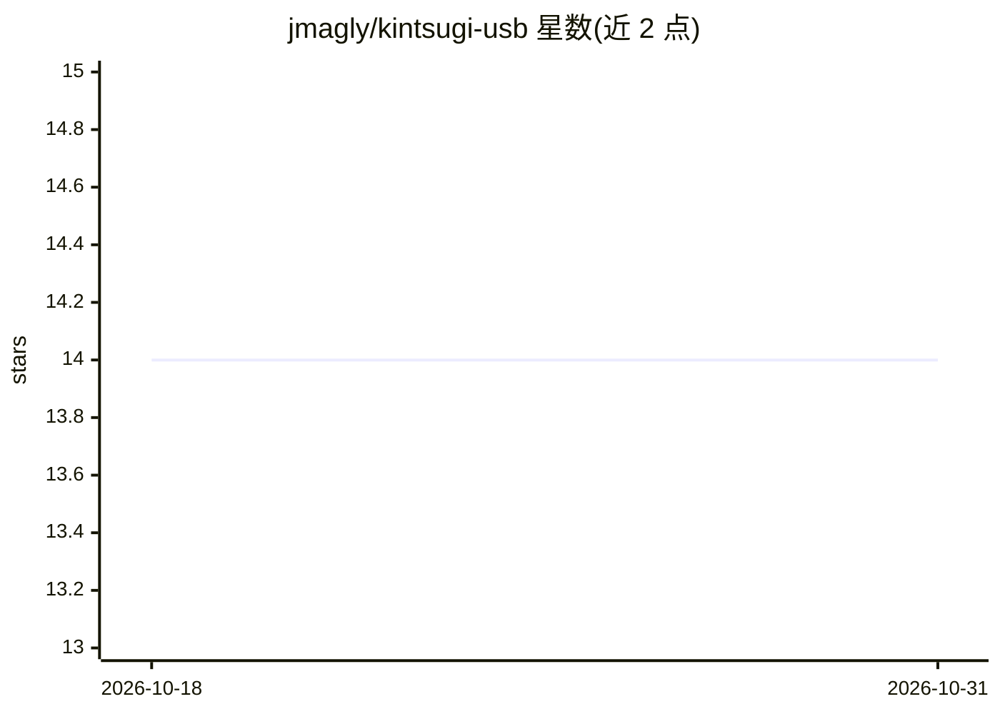

# jmagly/kintsugi-usb

⭐ 14 · Shell · NOASSERTION · 推送 2026-07-31 · [GitHub](https://github.com/jmagly/kintsugi-usb) · 个人维护

**给家用实验室/小机队运维者的 AI 辅助救援启动 U 盘**

基于 Ventoy + Xubuntu Minimal 24.04（带持久化）的多重启动救援 U 盘：内置 SystemRescue、Clonezilla 等救援 ISO、离线 LLM 运行时（Ollama，llama.cpp 可用，模型存于持久化分区 /data/ollama/models，默认不附带权重）、八个预装 agentic CLI（Claude Code、Codex、OpenCode、Copilot 等，需用户自行登录）以及供 AI 代理读取的主机恢复 runbook。仓库同时是构建工具链：一条命令 kintsugi-build 将官方 Xubuntu ISO 重制为可刷写的 .img.zst。面向家用实验室与小规模机队运维者；发布采用 CalVer 与 sha256 校验，minisign 签名计划 v1.1 落地。

## 筛选速览

| 维度 | 判定 | 备注 |
|---|---|---|
| AI 角色 | `ai-enhanced` | 去掉 AI 部分产品仍成立 |
| 许可风险 | `permissive` | NOASSERTION |
| 部署形态 | `None` |  |
| 模型依赖 | local-ok | 支持本地模型 |
| 硬件要求 | — | 无带数字的原话,不猜 |
| 安装摩擦 | `low` | 无编译、无系统依赖或容器化 |
| 成熟度 | — | 结构信号不足 |

## 能力要点

- Ventoy 多重启动 + 持久化分区，模型与状态重启后保留
- Ollama 离线推理栈预装，权重按 ADR-005 不随镜像分发
- 八个 agentic CLI 离线预装，凭据由用户刷写后自行登录
- 一条命令 kintsugi-build 完成从全新克隆到可刷写镜像的无人值守构建

## 适用场景

- 系统损坏时从 U 盘启动做救援与修复，断网也可用
- 让本地 AI 助手读取主机专属 runbook 协助排障
- 自行定制模型集合与代理工具，制作机队专用的救援 U 盘

## 场景标签

`AI 助手` · 领域:对话与助手

## 证据(README 行号)

> L5: AI-assisted rescue boot media for broken systems. A Ventoy multi-boot USB on Xubuntu Minimal 24.04 (XFCE, with persi
> L23: A "final level of recovery" for home-lab and small-fleet operators: **one USB that works whether the internet is up
> L33: - **Offline AI stack** — Ollama (with `llama.cpp` available) as a local runtime, pre-installed and wired to a persi

## 星数曲线

2026-10-18 14 → 2026-10-31 14（+0）

---
*卡片 v1 · prompt 1.4 · 生成 2026-10-31 · 置信度 high · 依据 README sha `d1a99264c837` · [字段定义](../../DATASET.md)*
