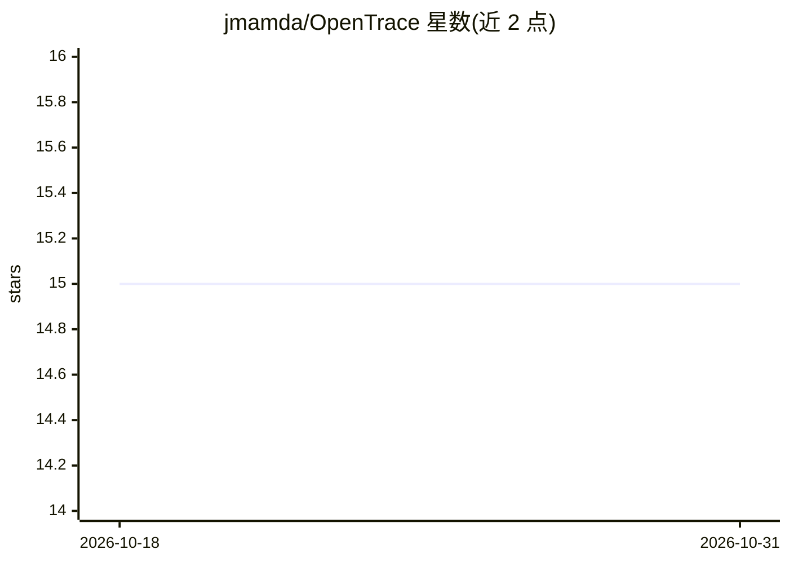

# jmamda/OpenTrace

⭐ 15 · Rust · MIT · 推送 2026-03-01 · [GitHub](https://github.com/jmamda/OpenTrace) · 个人维护

**本地反向代理记录全部 LLM 调用到 SQLite 的 Rust 单二进制工具**

单个 Rust 二进制文件，作为本地反向代理运行，把应用发出的每个 LLM 请求与响应写入本机 SQLite 文件（~/.trace/trace.db），数据不出本机。面向使用 LLM API 的开发者：改一个 OPENAI_BASE_URL 环境变量即可接入，无需改代码。提供 CLI（query/stats/watch/search/export）与本地 Web 仪表盘，支持请求脱敏、字段排除、按模型配置价格、预算告警、Prometheus 指标、OTLP 导出与 CI 成本报告。默认数据保留 90 天，DB 写入在容量 2 万条的有界后台通道上进行，极端负载下丢弃记录而非阻塞请求。

## 筛选速览

| 维度 | 判定 | 备注 |
|---|---|---|
| AI 角色 | `ai-ecosystem` | LLM/agent 周边工具 |
| 许可风险 | `permissive` | MIT |
| 部署形态 | `library` | 以包/库形式分发 |
| 模型依赖 | — | README 未给出锁定关系 |
| 硬件要求 | — | 无带数字的原话,不猜 |
| 安装摩擦 | `low` | 无编译、无系统依赖或容器化 |
| 成熟度 | — | 结构信号不足 |

## 能力要点

- 单二进制 + 单 SQLite 文件，代理路径通过环境变量切换即可接入
- CLI 与本地 Web 仪表盘：查询、统计、实时 tail、FTS5 全文搜索、JSONL/CSV 导出
- 请求脱敏（--redact-fields/--no-request-bodies）与 X-Trace-Tag 调用打标
- trace report/eval 可用于 CI 成本与质量门禁（--fail-over-usd、规则检查）

## 适用场景

- 本地记录并审计应用对 OpenAI/Anthropic 等 LLM API 的全部调用
- 在 CI 中检查 LLM 支出并在超预算时失败
- 实时观察调用延迟、token 与成本，按模型/端点聚合统计

## 场景标签

`LLM 可观测性` · 领域:评测与运维

## 证据(README 行号)

> L3: > **The `strace` of LLM calls.** A single Rust binary that acts as a local reverse proxy, recording every LLM reques
> L71: No code changes. The proxy passes all headers through unchanged, including your `Authorization` header.
> L98: |`-u, --upstream`|`TRACE_UPSTREAM`|`https://api.openai.com`|Upstream LLM API base URL|

## 星数曲线

2026-10-18 15 → 2026-10-31 15（+0）

---
*卡片 v1 · prompt 1.4 · 生成 2026-10-30 · 置信度 high · 依据 README sha `a717bb4f42c1` · [字段定义](../../DATASET.md)*
