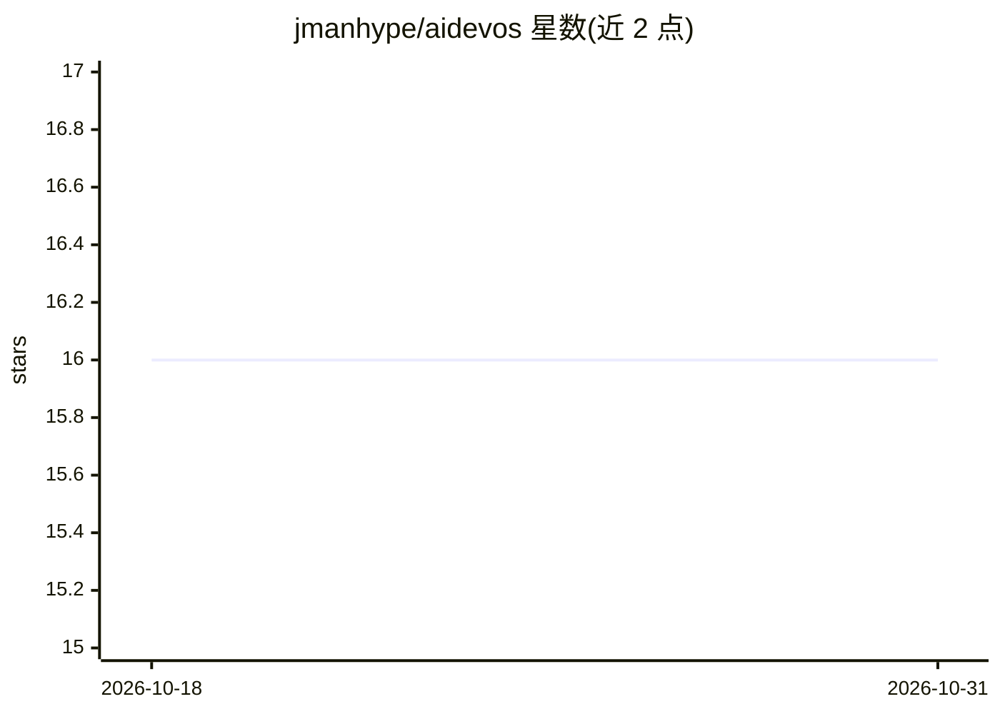

# jmanhype/aidevos

⭐ 16 · Python · 推送 2026-03-25 · [GitHub](https://github.com/jmanhype/aidevos) · [官网](https://github.com/jmanhype/aidevos) · 个人维护

**多智能体协作系统：AI 角色（PM/开发/DevOps 等）自动开发并部署 SaaS 应用**

多智能体系统，定义 PM、后端、前端、DevOps、QA、安全、UX 七类角色，接收产品需求后通过辩论/反思循环讨论并细化架构，生成任务分解、架构文档与部署配置，目标是经 CI/CD 流水线迭代编写、测试和部署代码。智能体基于基类加 DSPy 模块实现 LLM 交互，技术栈为 Python 3.10+、FastAPI、LangChain。README 自述为架构原型：运行系统不完整、无测试、无前端代码。

## 筛选速览

| 维度 | 判定 | 备注 |
|---|---|---|
| AI 角色 | `ai-ecosystem` | LLM/agent 周边工具 |
| 许可风险 | `none` | — |
| 部署形态 | `library` | 以包/库形式分发 |
| 模型依赖 | — | README 未给出锁定关系 |
| 硬件要求 | — | 无带数字的原话,不猜 |
| 安装摩擦 | `low` | 无编译、无系统依赖或容器化 |
| 成熟度 | `idea` | |

## 能力要点

- 七类角色智能体协作，含辩论/反思循环的架构讨论机制
- 从产品需求生成任务分解、架构文档与部署配置
- 智能体基于 DSPy 模块实现 LLM 交互

## 适用场景

- 输入产品规格自动生成架构方案与任务分解
- 研究多智能体分工协作的 DevOps 自动化流程
- 作为多智能体系统架构设计的参考原型

## 场景标签

`多智能体` `Agent 框架` `编码 Agent` · 领域:Agent 开发

## 证据(README 行号)

> L3: Multi-agent system where AI agents (PM, Backend, Frontend, DevOps, QA, Security) collaborate to architect and deploy
> L24: Agents are implemented in `src/agents/` using a base agent class with DSPy modules for LLM interaction.
> L31: |AI|OpenAI, LangChain, DSPy|

## 星数曲线

2026-10-18 16 → 2026-10-31 16（+0）

---
*卡片 v1 · prompt 1.4 · 生成 2026-10-30 · 置信度 low · 依据 README sha `f88584543231` · [字段定义](../../DATASET.md)*
