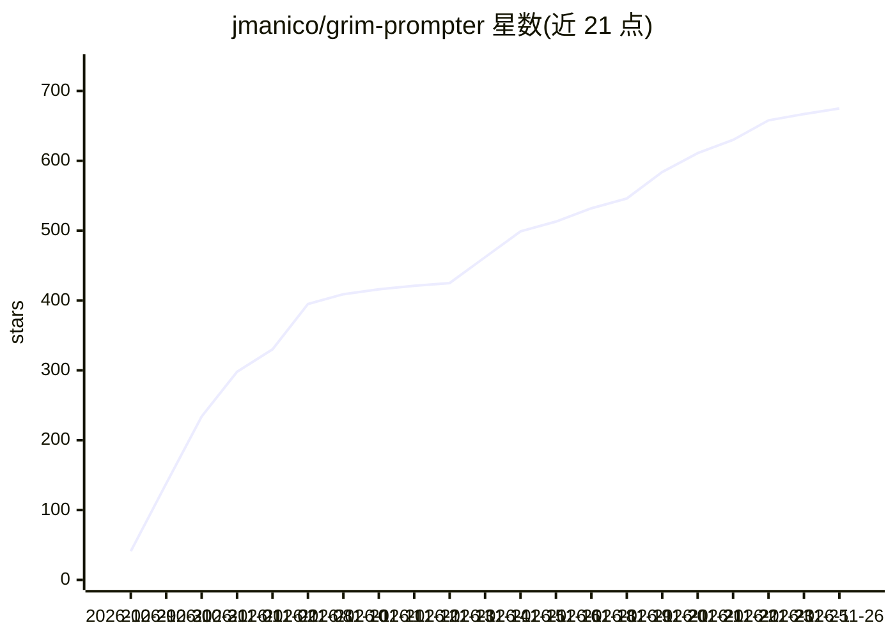

# jmanico/grim-prompter

⭐ 675 · MIT · 推送 2026-11-08 · [GitHub](https://github.com/jmanico/grim-prompter) · 个人维护

**为 AI 编码 agent 提供威胁建模提示词库**

一套以 skill/提示词形式分发的威胁建模素材库：克隆后将 threat-model 技能链接进 Claude Code、Codex 等编码 agent，agent 按其 runbook 对目标仓库执行只读检查，生成带文件与行号引用的威胁模型，输出写入 threat-model/ 目录（SYSTEM_UNDER_REVIEW.md、report.md、JSON 产物）。提供 36 种架构工作流与 29 种方法提示，支持 quick/deep 六阶段流程、隐私审查（LINDDUN、GDPR/CCPA 档案）与基于基线的变更复审。MIT 许可。

## 筛选速览

| 维度 | 判定 | 备注 |
|---|---|---|
| AI 角色 | `ai-knowledge` | 知识聚合/清单类 |
| 许可风险 | `permissive` | MIT |
| 部署形态 | `None` |  |
| 模型依赖 | — | README 未给出锁定关系 |
| 硬件要求 | — | 无带数字的原话,不猜 |
| 安装摩擦 | `low` | 无编译、无系统依赖或容器化 |
| 成熟度 | — | 结构信号不足 |

## 能力要点

- 36 种架构工作流与 29 种方法提示词
- 输出带文件与行号引用的证据可核查威胁模型
- 支持 LINDDUN 隐私方法与 GDPR/CCPA/CPRA 档案
- 基于 JSON 基线的变更复审流程

## 适用场景

- 用 Claude Code 对自己的仓库跑一次威胁建模
- 在安全审查中加入数据处理与隐私伤害分析
- 对比 feature 分支相对主干的威胁模型变化

## 场景标签

`提示工程` `网络安全` · 领域:Agent 开发

## 证据(README 行号)

> L5:  Threat modeling for AI coding agents.
> L8: **Threat model your project with Claude Code, Codex, or another coding agent.** Grim Prompter provides 36 architectu
> L13: ## Install

## 星数曲线

2026-10-29 41 → 2026-11-26 675（+634）

---
*卡片 v1 · prompt 1.4 · 生成 2026-11-24 · 置信度 high · 依据 README sha `34121faaa305` · [字段定义](../../DATASET.md)*
