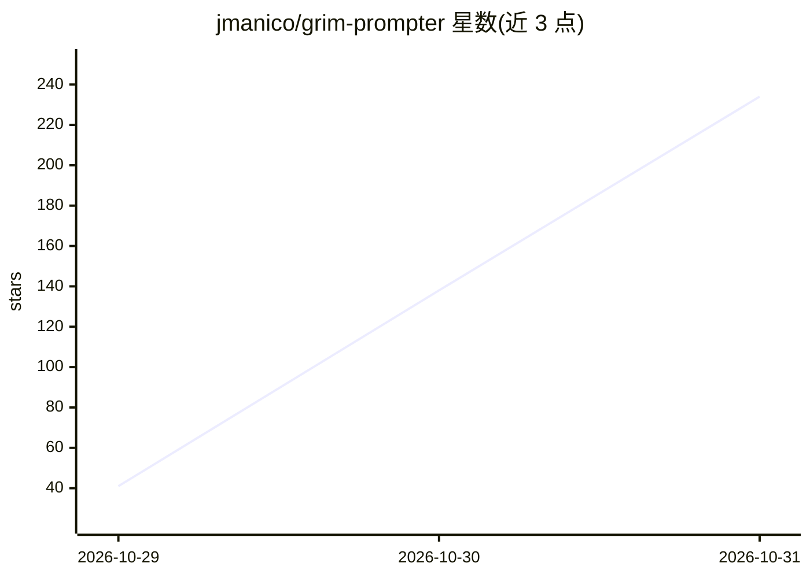

# jmanico/grim-prompter

⭐ 234 · MIT · 推送 2026-10-29 · [GitHub](https://github.com/jmanico/grim-prompter) · 个人维护

**面向 AI 编码代理的威胁建模技能库：36 架构、29 方法**

供 Claude Code、Codex 等编码代理使用的威胁建模 skill 与提示集合：将仓库克隆到本地后，把 threat-model skill 链接进代理，代理按 runbook 只读检查代码、信任边界、威胁与既有控制项，输出带文件与行号引证的分析，产物写入 threat-model/ 目录（SYSTEM_UNDER_REVIEW.md、report.md、JSON 基线）。支持 quick/deep 六阶段流程、变更审查及 MCP 工具凭证边界检查；要求构建、测试、网络访问需用户明确授权。

## 筛选速览

| 维度 | 判定 | 备注 |
|---|---|---|
| AI 角色 | `ai-ecosystem` | LLM/agent 周边工具 |
| 许可风险 | `permissive` | MIT |
| 部署形态 | `None` |  |
| 模型依赖 | locked-api |  |
| 硬件要求 | — | 无带数字的原话,不猜 |
| 安装摩擦 | `low` | 无编译、无系统依赖或容器化 |
| 成熟度 | — | 结构信号不足 |

## 能力要点

- 36 种架构工作流与 29 种威胁分析方法（STRIDE/PASTA/LINDDUN/MITRE ATLAS 等）
- 分析结果附文件与行号引证，可对照代码核查
- deep 模式为六阶段流程，各阶段读取前一阶段产物，JSON 基线支持变更审查
- runbook 限定只读检查，构建/测试/网络访问需明确授权

## 适用场景

- 让我的编码代理对项目做 STRIDE 或 PASTA 威胁分析
- 审查分支变更对既有威胁模型的影响
- 为 RAG、Agentic AI 等架构生成可追溯的威胁模型

## 场景标签

`网络安全` `代码审查` · 领域:编码与开发

## 证据(README 行号)

> L8: **Threat model your project with Claude Code, Codex, or another coding agent.** Grim Prompter provides 36 architectu
> L12: Clone once, then link the `threat-model` skill into your agent. Check for an existing installation before running t
> L74: When asked to threat model this project, read `~/grim-prompter/runbook.md` and follow it.

## 星数曲线

2026-10-29 41 → 2026-10-31 234（+193）

---
*卡片 v1 · prompt 1.4 · 生成 2026-10-29 · 置信度 high · 依据 README sha `45e83ff789d2` · [字段定义](../../DATASET.md)*
