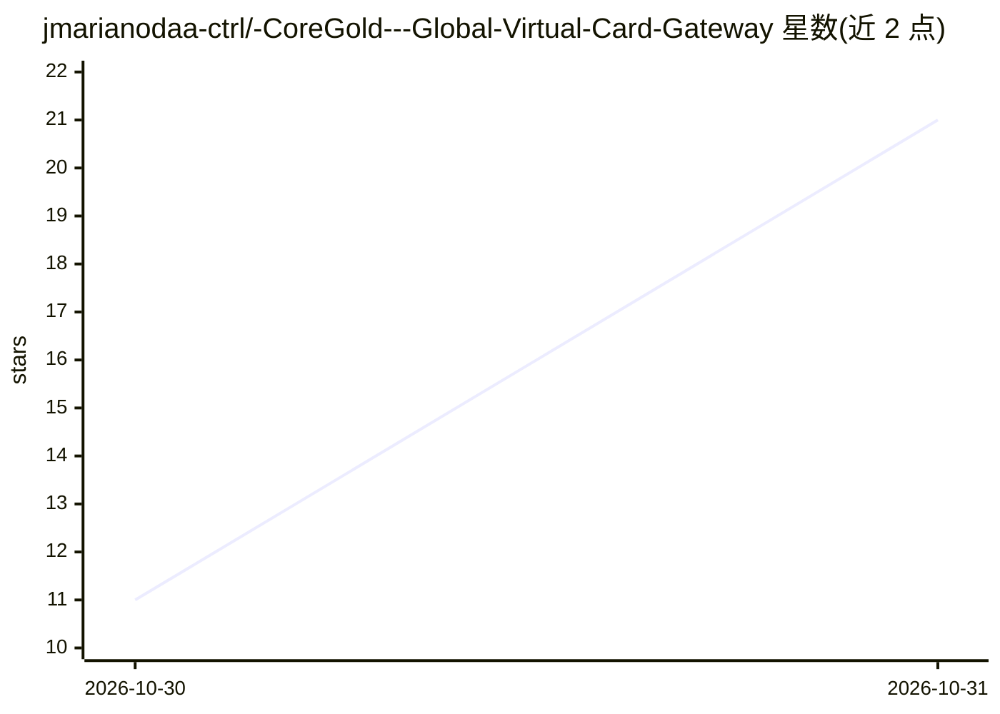

# jmarianodaa-ctrl/-CoreGold---Global-Virtual-Card-Gateway

⭐ 21 · 推送 2026-10-29 · [GitHub](https://github.com/jmarianodaa-ctrl/-CoreGold---Global-Virtual-Card-Gateway) · [官网](https://app.coregold.io/signup?invite_code=ADvlj9b) · 组织维护 · 中文 README

**面向出海业务的 Visa/Mastercard 虚拟信用卡发卡平台**

CoreGold 是一个商业虚拟信用卡（VCC）发卡服务：宣称直连海外银行清算网关，提供商业级 Visa/Mastercard 卡段、USDT 链上充值结算、批量开卡（独立卡号/有效期/CVV）、单商户指纹锁定与支出限额、注销卡片余额回退主账户等功能。面向海外广告投放、跨境电商独立站与海外 SaaS 采购用户。使用方式为注册其线上控制台，无本地安装或源码。README 中的 AI 相关内容仅为可绑卡消费的目标服务列举。

## 筛选速览

| 维度 | 判定 | 备注 |
|---|---|---|
| AI 角色 | `ai-enhanced` | 去掉 AI 部分产品仍成立 |
| 许可风险 | `none` | — |
| 部署形态 | `None` |  |
| 模型依赖 | — | README 未给出锁定关系 |
| 硬件要求 | — | 无带数字的原话,不猜 |
| 安装摩擦 | `low` | 无编译、无系统依赖或容器化 |
| 成熟度 | — | 结构信号不足 |

## 能力要点

- 提供 USDT 链上充值并按实时汇率结算为美元余额
- 支持批量开卡，每卡独立 16 位卡号、有效期与 CVV
- 单卡可锁定唯一扣费商户并配置单笔与周期支出上限
- 卡片注销后未消耗额度回退至主账户余额

## 适用场景

- 为 Facebook/TikTok/Google Ads 等海外广告账户配置独立付款卡
- 为 OpenAI API、Claude、Cursor 等 AI 服务订阅与按量付费绑卡
- 为多店铺矩阵分配一店一卡以隔离资金关联

## 场景标签

 · 领域:跨境支付/金融服务

## 证据(README 行号)

> L3: # 🚀 CoreGold - 击穿拒付与封号底层：高权重跨境商用虚拟信用卡发卡平台
> L5: > **TL;DR**：专为出海买量操盘手、跨境电商独立站与开发者打造的一级银行直连虚拟信用卡（VCC）发卡管理系统。支持 USDT 充值即刻秒开、多项目物理隔离、单卡商户指纹强绑定与余额秒级回流，告别海外平台绑卡拒付、资金连带封停
> L33: |**AI 生产力与开发框架**|`OpenAI API 绑卡`, `Claude 3.7 / Code`, `Cursor`, `Midjourney`|突破发卡地域限制，稳定扣除高阶会员与按量 API 费用，不降权不拒付|

## 星数曲线

2026-10-30 11 → 2026-10-31 21（+10）

---
*卡片 v1 · prompt 1.4 · 生成 2026-10-30 · 置信度 mid · 依据 README sha `3fc2502d078a` · [字段定义](../../DATASET.md)*
