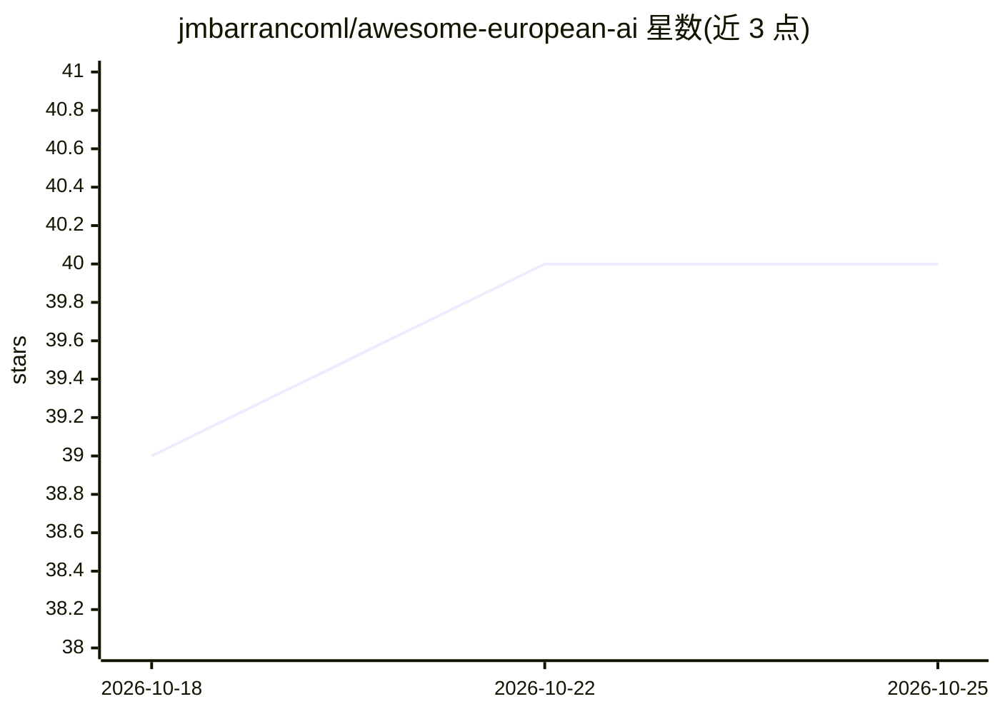

# jmbarrancoml/awesome-european-ai

⭐ 40 · Python · CC0-1.0 · 推送 2026-10-24 · [GitHub](https://github.com/jmbarrancoml/awesome-european-ai) · 个人维护

**欧洲 AI 生态策展清单：收录公司、研究实验室与开源项目**

一个 Awesome 类策展清单，按公司、研究实验室等类别收录欧洲 AI 领域条目，使用 CC0-1.0 许可。公司部分分为基础模型、应用 AI、AI 基础设施与 AI 工具四节，以表格列出公司、国家、方向与备注（含融资/估值/收购信息）；研究实验室部分收录 DeepMind、ELLIS、Inria 等 10 家机构。清单开头声明其关注点为透明度、数据主权与 GDPR 合规。条目含 GitHub stars、最近提交与链接检查等徽章。

## 筛选速览

| 维度 | 判定 | 备注 |
|---|---|---|
| AI 角色 | `ai-knowledge` | 知识聚合/清单类 |
| 许可风险 | `viral` | CC0-1.0 |
| 部署形态 | `None` |  |
| 模型依赖 | — | README 未给出锁定关系 |
| 硬件要求 | — | 无带数字的原话,不猜 |
| 安装摩擦 | `low` | 无编译、无系统依赖或容器化 |
| 成熟度 | — | 结构信号不足 |

## 能力要点

- 按基础模型/应用 AI/基础设施/AI 工具四类组织 150+ 家公司条目
- 每条含国家、方向与融资/收购等备注信息
- 收录 10 家欧洲学术与政府背景研究实验室
- 以透明度、数据主权与 GDPR 合规为收录叙事主线

## 适用场景

- 查找欧洲本土的基础模型、云与推理服务供应商
- 了解欧洲 AI 研究实验室的分布与研究方向
- 按国家/领域筛选欧洲 AI 公司条目

## 场景标签

`精选清单` · 领域:学习与行业

## 证据(README 行号)

> L11: A curated list of European AI companies, research labs, open source projects, and resources.
> L13: Europe is building its own AI ecosystem with a focus on transparency, data sovereignty, and GDPR compliance. This l

## 星数曲线

2026-10-18 39 → 2026-10-25 40（+1）

---
*卡片 v1 · prompt 1.4 · 生成 2026-10-25 · 置信度 high · 依据 README sha `db895799e44d` · [字段定义](../../DATASET.md)*
