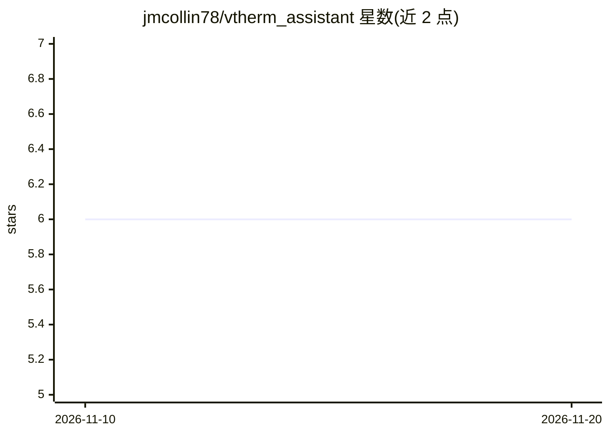

# jmcollin78/vtherm_assistant

⭐ 6 · Python · MIT · 推送 2026-11-09 · [GitHub](https://github.com/jmcollin78/vtherm_assistant) · 个人维护

**为 Versatile Thermostat 用户提供的对话式诊断与操作助手**

Home Assistant 应用，通过 HA 的 MCP 服务器动态发现 VTherm 温控器的读取与写入工具，用自然语言解释温控器状态、历史与日志，诊断不加热等情形，并可搜索多语言官方文档。执行写操作（改模式/温度/预设/开关）前需在 UI 中逐条强制审批。依赖 Home Assistant、Versatile Thermostat 集成与 MCP 配置；诊断不保证根因。以 HA OS 应用仓库形式安装。

## 筛选速览

| 维度 | 判定 | 备注 |
|---|---|---|
| AI 角色 | `ai-native` | 本体是模型或模型工具 |
| 许可风险 | `permissive` | MIT |
| 部署形态 | `None` |  |
| 模型依赖 | local-ok | 支持本地模型 |
| 硬件要求 | — | 无带数字的原话,不猜 |
| 安装摩擦 | `low` | 无编译、无系统依赖或容器化 |
| 成熟度 | — | 结构信号不足 |

## 能力要点

- 动态发现 HA MCP 服务器发布的 VTherm 工具（读与写）
- 温控器状态汇总、历史/日志检查与情况解释
- 多语言在线官方文档检索并引用来源页
- 每个写工具调用需在 UI 单独强制审批

## 适用场景

- 询问家里温控器为何停止加热并获取排查建议
- 对话方式查看温控器完整状态与运行历史
- 通过对话切换预设、改变目标温度或开关温控器

## 场景标签

`AI 助手` · 领域:对话与助手

## 证据(README 行号)

> L5: A conversational assistant for diagnosing and understanding [Versatile
> L20: Assistant MCP server whose schemas it accepts, for both reads and writes. It
> L41: The assistant can also request a VTherm change exposed by the integration, for

## 星数曲线

2026-11-10 6 → 2026-11-20 6（+0）

---
*卡片 v1 · prompt 1.4 · 生成 2026-11-20 · 置信度 high · 依据 README sha `dcc1a5070ca2` · [字段定义](../../DATASET.md)*
