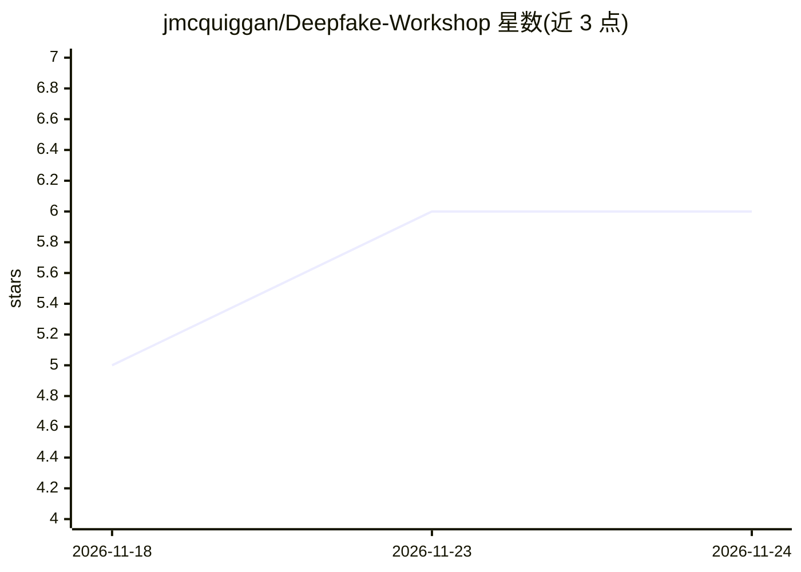

# jmcquiggan/Deepfake-Workshop

⭐ 6 · 推送 2026-11-17 · [GitHub](https://github.com/jmcquiggan/Deepfake-Workshop) · [官网](https://www.antisyphontraining.com/product/workshop-build-a-deepfake-learn-the-defense/) · 个人维护

**Deepfake 研讨会的配套资源仓库**

存放 Deepfake Workshop 所需文件的资源仓库，README 仅说明该仓库包含研讨会所需的文件，未展开描述具体内容、安装步骤或使用方式。从主题标签（ai、deepfakes、lipsync）推断与深度伪造及口型同步技术的工作坊教学相关。除这一句说明外，README 未提供其他可验证信息。

## 筛选速览

| 维度 | 判定 | 备注 |
|---|---|---|
| AI 角色 | `ai-knowledge` | 知识聚合/清单类 |
| 许可风险 | `none` | — |
| 部署形态 | `None` |  |
| 模型依赖 | — | README 未给出锁定关系 |
| 硬件要求 | — | 无带数字的原话,不猜 |
| 安装摩擦 | `low` | 无编译、无系统依赖或容器化 |
| 成熟度 | — | 结构信号不足 |

## 能力要点

- 包含 Deepfake Workshop 所需的文件资源

## 适用场景

- 参加 deepfake 研讨会时获取配套文件
- 回顾研讨会使用的材料

## 场景标签

`教程课程` `图像视频处理` · 领域:学习与行业

## 证据(README 行号)

> L1: This repository contains the files needed for the Deepfake Workshop

## 星数曲线

2026-11-18 5 → 2026-11-24 6（+1）

---
*卡片 v1 · prompt 1.4 · 生成 2026-11-21 · 置信度 low · 依据 README sha `ba1db3055cbb` · [字段定义](../../DATASET.md)*
