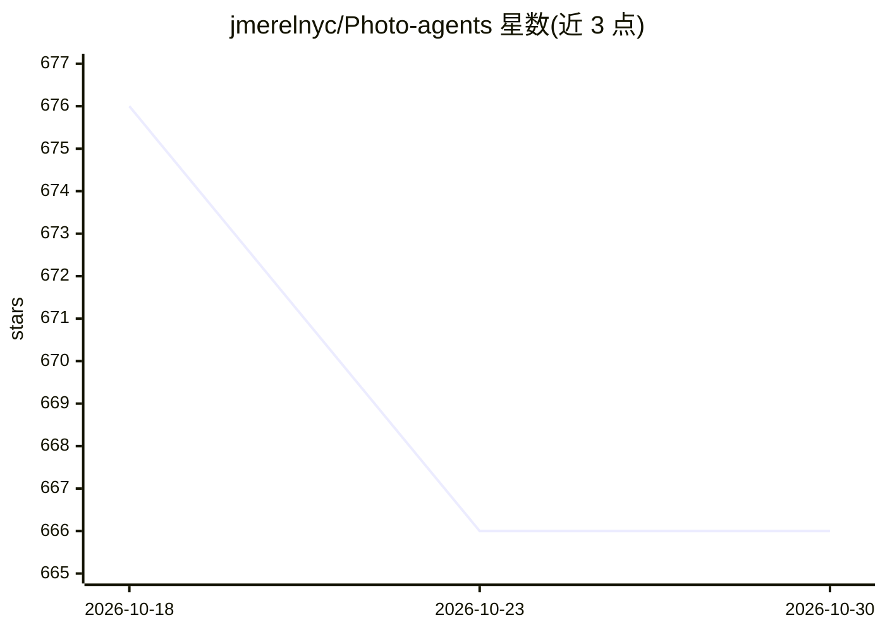

# jmerelnyc/Photo-agents

⭐ 666 · Python · MIT · 推送 2026-07-03 · [GitHub](https://github.com/jmerelnyc/Photo-agents) · 组织维护

**视觉感知驱动的自主 LLM agent 运行时框架**

Photo Agents 是一个 Python 包形式的 agent 运行时，实现感知→推理→行动循环，驱动任意工具调用型 LLM 操作用户电脑。核心机制：视觉输入驱动的分层记忆（working/global/SOP/会话归档）、agent 从成功任务中自行编写技能并建立向量索引、多提供商 LLM 路由（Anthropic Claude 与 OpenAI GPT 原生支持及 mixin 故障转移）。附带 Streamlit/PyQt 桌面端与 Telegram、飞书、企微、钉钉、QQ 等机器人客户端。运行由远程验证的 Photo Agents API key 门控（非完全离线），LLM 凭证需用户自行配置。当前为 beta 状态。

## 筛选速览

| 维度 | 判定 | 备注 |
|---|---|---|
| AI 角色 | `ai-ecosystem` | LLM/agent 周边工具 |
| 许可风险 | `permissive` | MIT |
| 部署形态 | `library` | 以包/库形式分发 |
| 模型依赖 | locked-api |  |
| 硬件要求 | — | 无带数字的原话,不猜 |
| 安装摩擦 | `low` | 无编译、无系统依赖或容器化 |
| 成熟度 | `idea` | |

## 能力要点

- 感知→推理→行动循环的流式 agent 运行时
- 分层记忆系统（working/global/SOP/session archive）
- agent 自写技能并维护技能/SOP 向量索引
- 多提供商 LLM 路由，Claude 与 GPT 原生支持、mixin 故障转移

## 适用场景

- 让 agent 基于屏幕视觉自主操作电脑完成任务
- 通过 Telegram、飞书、钉钉等 IM 客户端运行 agent
- 在本地积累 agent 记忆与技能库的长期任务执行

## 场景标签

`GUI 自动化` `Agent 框架` · 领域:Agent 开发

## 证据(README 行号)

> L7: Autonomous self-evolving **Photo Agents**. A perceive / reason / act framework for photo-aware agents that operate y
> L23: - A streaming **agent loop** that drives any tool-calling LLM through a perceive → reason → act cycle.
> L24: - A **multi-provider LLM router** with first-class support for Anthropic Claude (native) OpenAI GPT (native) and a 

## 星数曲线

2026-10-18 676 → 2026-10-30 666（-10）

---
*卡片 v1 · prompt 1.4 · 生成 2026-10-22 · 置信度 high · 依据 README sha `0adf7ed5b6f0` · [字段定义](../../DATASET.md)*
