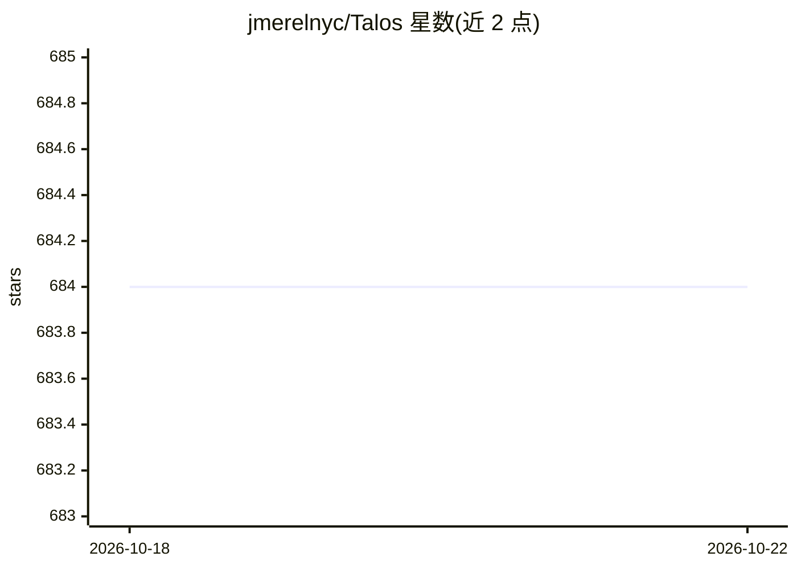

# jmerelnyc/Talos

⭐ 673 · Python · MIT · 推送 2026-07-08 · [GitHub](https://github.com/jmerelnyc/Talos) · [官网](https://usetalos.xyz) · 组织维护

**Talos 网络 GPU worker 客户端：共享本机 GPU 服务推理任务并赚取收益**

Talos 网络的可下载 worker 客户端：与用户的 Talos 账户通过设备码配对，经 WebSocket 接收网络分发的开源模型推理任务，交由本地 Ollama 执行，上报在线时长并按已服务任务结算收益。需 Python 3.9+ 与本地 Ollama（至少拉取一个模型），NVIDIA GPU 可自动检测（CPU 也可运行）。提供本地状态面板与 allocation 分配滑块；同一仓库还包含 talos-auto 编辑器接入配置（Cursor/VSCode/Claude Code 等）。

## 筛选速览

| 维度 | 判定 | 备注 |
|---|---|---|
| AI 角色 | `ai-ecosystem` | LLM/agent 周边工具 |
| 许可风险 | `permissive` | MIT |
| 部署形态 | `library` | 以包/库形式分发 |
| 模型依赖 | local-ok | 支持本地模型 |
| 硬件要求 | — | 无带数字的原话,不猜 |
| 安装摩擦 | `low` | 无编译、无系统依赖或容器化 |
| 成熟度 | — | 结构信号不足 |

## 能力要点

- 设备码配对后经 WebSocket 领取并执行推理任务
- 通过本地 Ollama 执行开源模型推理
- 本地 dashboard 展示实时状态，allocation 控制本机投入比例
- 按已服务任务结算收益并在 Talos dashboard 展示

## 适用场景

- 闲置 GPU 参与分布式推理网络换取收益
- 通过 allocation 滑块限制本机资源占用
- 为 Cursor/VSCode 等编辑器接入 talos-auto 托管网关

## 场景标签

 · 领域:分布式计算/LLM推理

## 证据(README 行号)

> L5: pairs with your Talos account using a code, then serves open-model inference
> L6: jobs from the network via your local Ollama, reporting
> L15: - Ollama running locally with at least one model pulled,

## 星数曲线

2026-10-18 684 → 2026-10-22 684（+0）

---
*卡片 v1 · prompt 1.4 · 生成 2026-10-21 · 置信度 high · 依据 README sha `9b5ffa0d9126` · [字段定义](../../DATASET.md)*
