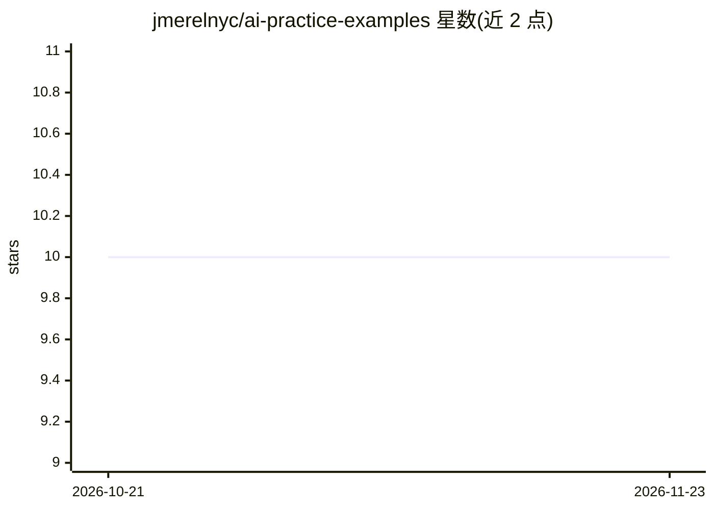

# jmerelnyc/ai-practice-examples

⭐ 10 · TypeScript · NOASSERTION · 推送 2026-05-01 · [GitHub](https://github.com/jmerelnyc/ai-practice-examples) · 个人维护

**TypeScript AI 工程实践示例集：演示生产级模式**

一套课程示例代码，针对 AI 教程常缺失的工程环节——错误处理、限流、prompt 版本管理、测试与监控——逐概念提供带测试与文档的实现示例。core/ 目录提供 prompt 模板、错误处理、限流等可复用工具；integrations/ 展示与具体 AI 提供商结合的模式；全部采用依赖注入便于测试。默认用 mock provider 跑测试，需真实 API key 的集成测试默认跳过。

## 筛选速览

| 维度 | 判定 | 备注 |
|---|---|---|
| AI 角色 | `ai-knowledge` | 知识聚合/清单类 |
| 许可风险 | `none` | NOASSERTION |
| 部署形态 | `library` | 以包/库形式分发 |
| 模型依赖 | — | README 未给出锁定关系 |
| 硬件要求 | — | 无带数字的原话,不猜 |
| 安装摩擦 | `low` | 无编译、无系统依赖或容器化 |
| 成熟度 | — | 结构信号不足 |

## 能力要点

- 按概念组织示例：错误处理、限流、prompt 版本管理、测试、监控
- core/ 提供可复用工具，integrations/ 展示与提供商集成的模式
- 全示例使用依赖注入，测试默认使用 mock provider

## 适用场景

- 学习 TypeScript 下 AI 应用的工程化模式
- 为自己的 AI 项目寻找可参考的实现写法
- 补齐 API 调用之外的生产环节（限流/重试/测试）

## 场景标签

`教程课程` · 领域:学习与行业

## 证据(README 行号)

> L3: Course examples demonstrating AI implementation with industry best practices
> L7: Most AI tutorials show you how to call an API and print the result. This misses the hard parts: error handling, rate

## 星数曲线

2026-10-21 10 → 2026-11-23 10（+0）

---
*卡片 v1 · prompt 1.4 · 生成 2026-11-19 · 置信度 high · 依据 README sha `dfab04c0db73` · [字段定义](../../DATASET.md)*
