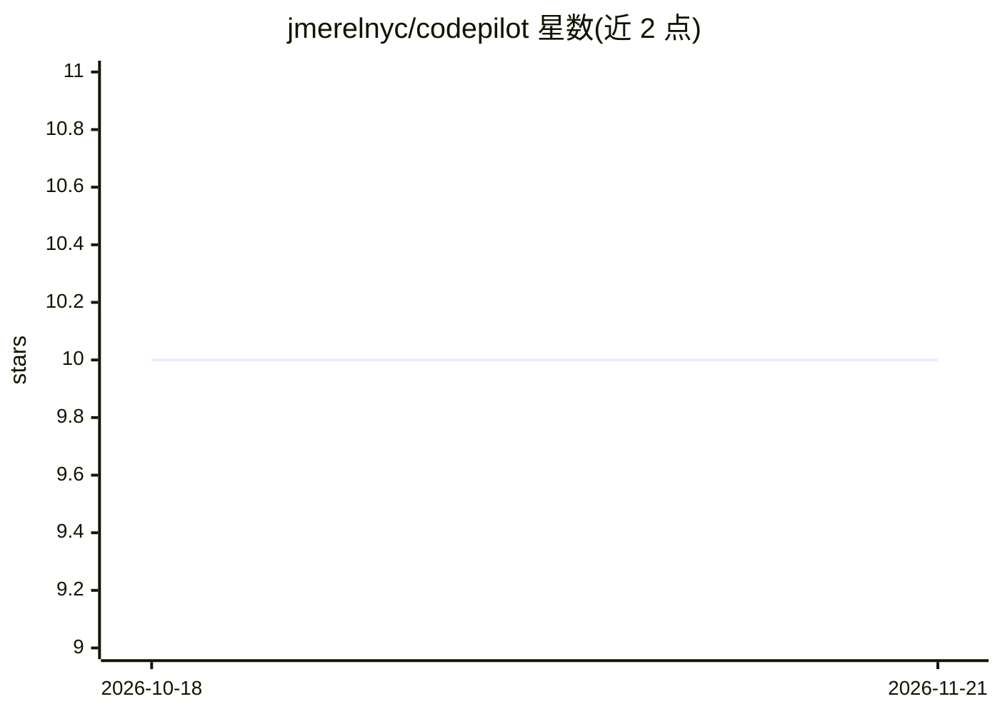

# jmerelnyc/codepilot

⭐ 10 · Go · MIT · 推送 2026-07-08 · [GitHub](https://github.com/jmerelnyc/codepilot) · 个人维护

**Go 开发者的 LLM 代码助手引擎库：统一接入多家模型**

用 Go 实现的 LLM 编程助手引擎库，面向需要在自己工具和工作流中集成 AI 编程能力的开发者。核心机制：提供抽象层把 completion/chat/流式输出等通用操作映射到各后端 API（每个适配器处理认证、请求格式与响应解析）；token 感知的上下文缓冲在发送前跟踪计数并强制限制；流式接口以迭代器模式逐 token 交付。另含独立于 LLM 的代码工具：语法感知分块、符号抽取、diff 生成。定位为可组合的库而非终端用户界面，安装方式为 go get。

## 筛选速览

| 维度 | 判定 | 备注 |
|---|---|---|
| AI 角色 | `ai-ecosystem` | LLM/agent 周边工具 |
| 许可风险 | `permissive` | MIT |
| 部署形态 | `None` |  |
| 模型依赖 | local-ok | 支持本地模型 |
| 硬件要求 | — | 无带数字的原话,不猜 |
| 安装摩擦 | `low` | 无编译、无系统依赖或容器化 |
| 成熟度 | — | 结构信号不足 |

## 能力要点

- provider 抽象层统一 OpenAI/Anthropic/本地模型接口，含认证与响应解析
- token 感知上下文管理，发送前强制限制避免截断
- 流式接口以迭代器模式增量处理生成内容，区分可重试与永久错误
- 语法感知分块/符号抽取/diff 生成可独立用于前后处理

## 适用场景

- 在自己的编辑器或构建工具中集成 LLM 代码生成能力
- 多后端模型切换而无需直接处理各家 HTTP API
- 对大文件做语法感知分块后再送入模型分析

## 场景标签

`代码生成` · 领域:编码与开发

## 证据(README 行号)

> L5: codepilot is an LLM programming assistant engine implemented in Go. The system provides programmatic access to large
> L9: The proliferation of large language models capable of generating and reasoning about code has created demand for pro

## 星数曲线

2026-10-18 10 → 2026-11-21 10（+0）

---
*卡片 v1 · prompt 1.4 · 生成 2026-11-19 · 置信度 high · 依据 README sha `8ded6d478a10` · [字段定义](../../DATASET.md)*
