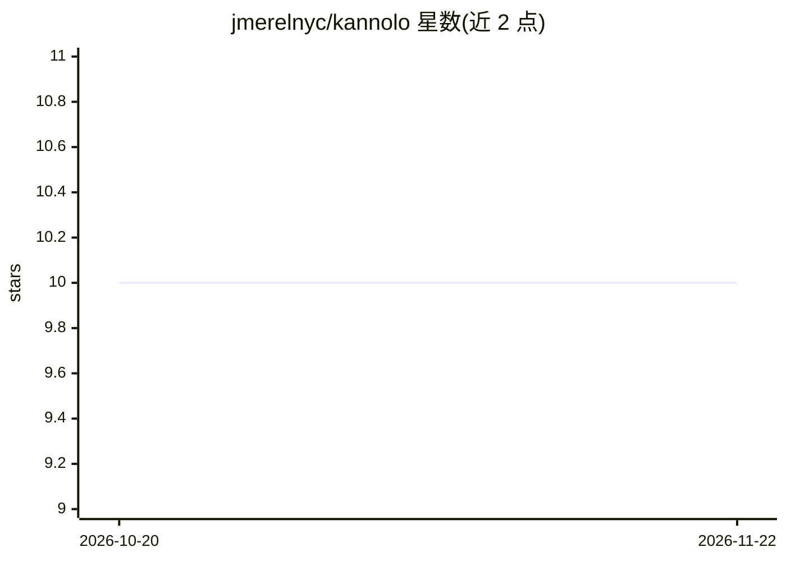

# jmerelnyc/kannolo

⭐ 10 · Rust · NOASSERTION · 推送 2026-05-01 · [GitHub](https://github.com/jmerelnyc/kannolo) · 个人维护

**Rust 库：构建与训练 Kolmogorov-Arnold 网络**

以 Rust crate 形式发布的 KAN（Kolmogorov-Arnold Network）库，提供 KAN 与 SplineConfig 等类型，支持通过 B 样条基构建可学习的边上单元函数，使用标准反向传播训练（样条系数为可学习参数）。README 给出 cargo add 安装方式、用法示例与 XOR 训练示例，并提供网格尺寸、样条阶数等配置说明。面向需要在 Rust 中使用 KAN 的开发者。

## 筛选速览

| 维度 | 判定 | 备注 |
|---|---|---|
| AI 角色 | `ai-native` | 本体是模型或模型工具 |
| 许可风险 | `none` | NOASSERTION |
| 部署形态 | `None` |  |
| 模型依赖 | — | README 未给出锁定关系 |
| 硬件要求 | — | 无带数字的原话,不猜 |
| 安装摩擦 | `low` | 无编译、无系统依赖或容器化 |
| 成熟度 | — | 结构信号不足 |

## 能力要点

- 提供 KAN 结构与 B 样条基的边上可学习单元函数
- 支持标准反向传播训练，样条系数为可学习参数
- 提供网格尺寸/样条阶数配置（默认建议 grid_size=5、阶数 3）
- cargo add 一行引入，附 XOR 训练示例

## 适用场景

- 在 Rust 项目中构建与训练 KAN 模型
- 需要比 MLP 更可解释的网络结构时使用
- 按网格尺寸调整样条分辨率做参数/表达能力权衡

## 场景标签

`模型训练` · 领域:训练与推理

## 证据(README 行号)

> L3: Official kANNolo library for Kolmogorov-Arnold neural network operations
> L18: KANs replace fixed activation functions with learnable univariate functions on edges. Each edge learns a spline (B-

## 星数曲线

2026-10-20 10 → 2026-11-22 10（+0）

---
*卡片 v1 · prompt 1.4 · 生成 2026-11-19 · 置信度 high · 依据 README sha `ecac46e02701` · [字段定义](../../DATASET.md)*
