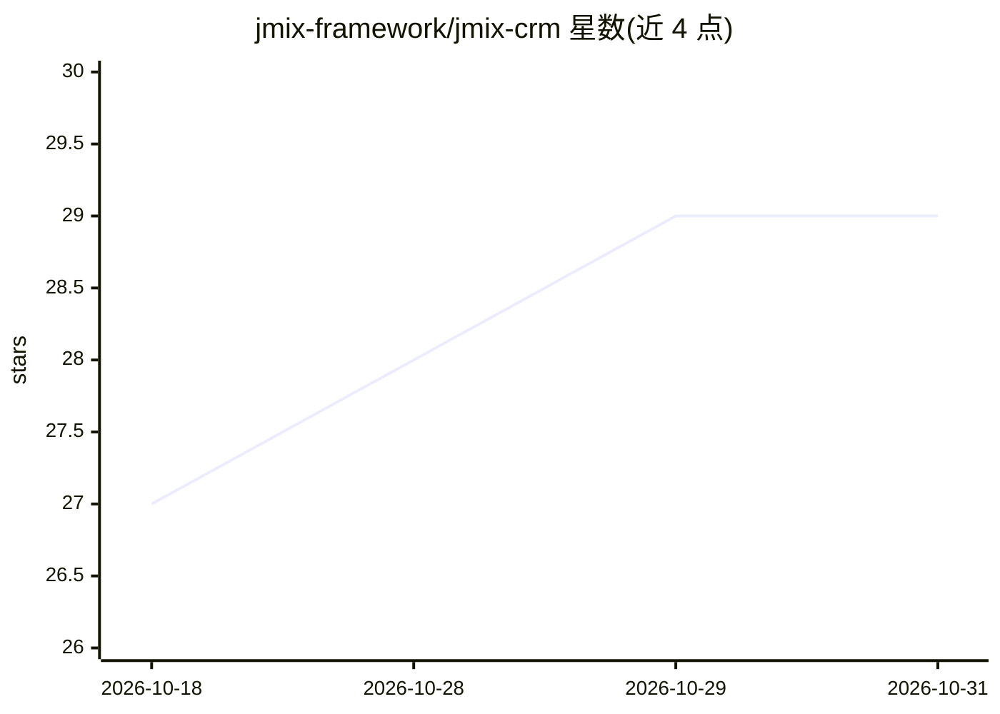

# jmix-framework/jmix-crm

⭐ 29 · Java · 推送 2026-10-29 · [GitHub](https://github.com/jmix-framework/jmix-crm) · [官网](https://demo.jmix.io/b2b-crm) · 组织维护

**基于 Jmix 的企业 B2B CRM 示例应用，内置 AI 助手**

由 Jmix 团队维护的企业级演示应用：以 Java 21、Spring Boot 与 Vaadin Flow 构建完整 B2B 销售流程，覆盖客户、联系人、订单、发票、收款、任务与销售漏斗看板。内置 CRM AI 工作区，通过自然语言分析销售数据，遵守用户数据权限，支持上传实体与文件到对话上下文、生成记录链接；需配置 spring.ai.openai.api-key 才能启用。本地 profile 自动生成演示数据，提供 Docker 与 Docker Compose 运行方式。README 明确其为演示应用，用于展示 Jmix 上企业应用的开发实践。

## 筛选速览

| 维度 | 判定 | 备注 |
|---|---|---|
| AI 角色 | `ai-enhanced` | 去掉 AI 部分产品仍成立 |
| 许可风险 | `none` | — |
| 部署形态 | `self-host` | docker 或自建部署 |
| 模型依赖 | — | README 未给出锁定关系 |
| 硬件要求 | — | 无带数字的原话,不猜 |
| 安装摩擦 | `low` | 无编译、无系统依赖或容器化 |
| 成熟度 | — | 结构信号不足 |

## 能力要点

- 自然语言分析客户/订单/发票/收款的 CRM AI 工作区，遵守用户数据权限
- 交互式销售漏斗（New→Accepted→In Progress→Done）与看板报表
- 分层角色模型（Administrator/Supervisor/Manager/Account Manager）
- 本地 profile 自动生成演示数据与示例账户

## 适用场景

- 学习用 Jmix 构建生产级企业 CRM 的架构与实践
- 体验自然语言查询销售数据的 AI 助手交互
- 作为企业内部业务系统的起点进行二次开发

## 场景标签

`数据分析` · 领域:效率与自动化

## 证据(README 行号)

> L7: `B2B CRM` is an enterprise demo application based on `Jmix framework` with built-in `AI` that showcases how to devel
> L78: The application includes a built-in `CRM AI` workspace for natural-language analysis of CRM data.
> L221: B2B CRM is a demo application designed to demonstrate production-ready architecture and enterprise development

## 星数曲线

2026-10-18 27 → 2026-10-31 29（+2）

---
*卡片 v1 · prompt 1.4 · 生成 2026-10-26 · 置信度 high · 依据 README sha `fd273a01087c` · [字段定义](../../DATASET.md)*
