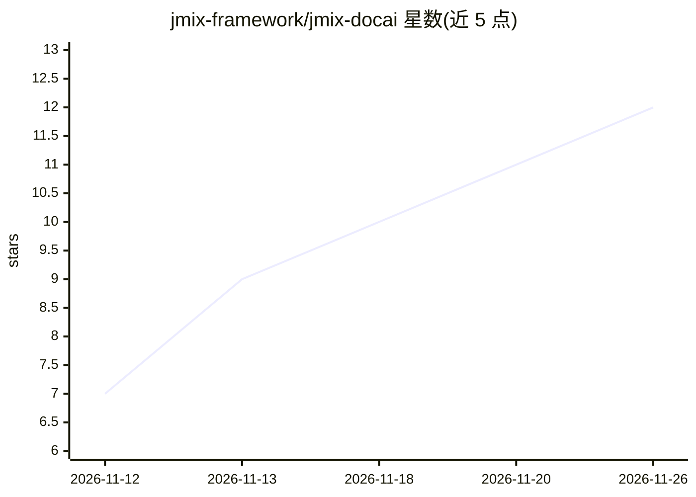

# jmix-framework/jmix-docai

⭐ 12 · Java · Apache-2.0 · 推送 2026-11-23 · [GitHub](https://github.com/jmix-framework/jmix-docai) · [官网](https://demo.jmix.io/docai/) · 组织维护

**面向开发者的 Jmix 文档管理示例应用，含语义搜索与 RAG 助手**

基于 Jmix 3.1 构建的参考级文档管理系统演示应用：提供文件夹树、版本、权限继承、状态流转、标签、回收站等文档管理功能，以及全文搜索与按语义搜索。AI 部分基于 Spring AI 实现，默认接 OpenAI：从文件自动填充文档卡片字段、单文档与多文档讨论聊天、以及基于 RAG 的全库 AI 助手。构建运行需 Java 21、Docker Compose（OpenSearch）和 Jmix Enterprise 订阅凭证（用于 AI Chat 附加组件），提供英文/俄文演示数据，无 OpenAI key 时 AI 功能全部隐藏。

## 筛选速览

| 维度 | 判定 | 备注 |
|---|---|---|
| AI 角色 | `ai-native` | 本体是模型或模型工具 |
| 许可风险 | `permissive` | Apache-2.0 |
| 部署形态 | `self-host` | docker 或自建部署 |
| 模型依赖 | — | README 未给出锁定关系 |
| 硬件要求 | — | 无带数字的原话,不猜 |
| 安装摩擦 | `low` | 无编译、无系统依赖或容器化 |
| 成熟度 | — | 结构信号不足 |

## 能力要点

- 从文档文件自动填充类型、字段、日期与标签（Fill with AI）
- 基于语义检索（RAG）回答全库问题的 AI 助手，回答带引用与链接
- AI 按提问者权限工作，无权打开的文档不会被读取或展示
- 可替换为 Anthropic/Azure OpenAI/Gemini/Mistral/Ollama 等 Spring AI 供应商

## 适用场景

- 在 Jmix 上构建企业文档管理系统时参考其实现
- 搭建带语义搜索与文档问答的内部知识库
- 评估文档入库成本与 AI 功能的文本外发范围

## 场景标签

`文档问答` `RAG` `语义搜索` · 领域:知识与检索

## 证据(README 行号)

> L3: Jmix DocAI is a reference document management system with AI, built on Jmix 3.1. It shows developers how to build a 
> L46: The AI features run on Spring AI, with OpenAI by default, and work with the rights of the person who asks: the AI n
> L134: - Credentials of the Jmix premium repository, for the AI Chat add-on: they come with a Jmix Enterprise subscriptio

## 星数曲线

2026-11-12 7 → 2026-11-26 12（+5）

---
*卡片 v1 · prompt 1.4 · 生成 2026-11-19 · 置信度 high · 依据 README sha `d27ec613ea86` · [字段定义](../../DATASET.md)*
