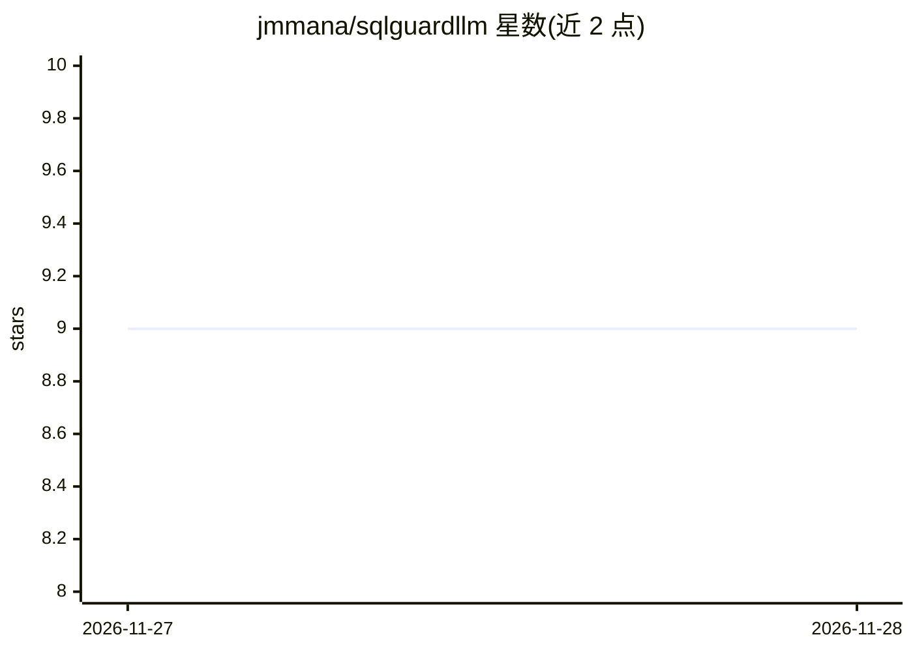

# jmmana/sqlguardllm

⭐ 9 · Python · Apache-2.0 · 推送 2026-11-27 · [GitHub](https://github.com/jmmana/sqlguardllm) · [官网](https://jmmana.github.io/sqlguardllm/) · 个人维护

**为 LLM 应用校验并改写 AI 生成 SQL 的防火墙库**

构建于 sqlglot 之上的 SQL 校验与改写层：将模型生成的 SQL 解析为语法树，按策略判定是否为只读单语句、表/列白名单、行级过滤与行数上限，并重写通过的查询返回给应用执行。支持 32 种方言、可选复杂度限制与列掩码；提供 Python 引擎、Node.js/.NET 客户端、CLI、HTTP serve 与 MCP server，附 CI 工具与 148 用例开发语料。当前为 alpha（0.5.0a2），API 可能变动，违规码保持稳定。

## 筛选速览

| 维度 | 判定 | 备注 |
|---|---|---|
| AI 角色 | `ai-ecosystem` | LLM/agent 周边工具 |
| 许可风险 | `permissive` | Apache-2.0 |
| 部署形态 | `self-host` | docker 或自建部署 |
| 模型依赖 | — | README 未给出锁定关系 |
| 硬件要求 | — | 无带数字的原话,不猜 |
| 安装摩擦 | `low` | 无编译、无系统依赖或容器化 |
| 成熟度 | `idea` | |

## 能力要点

- 基于 sqlglot 语法树判定而非关键词匹配，无法解析时拒绝
- 重写查询注入行级过滤并应用 LIMIT/TOP/FETCH FIRST，支持 32 种方言
- 提供 Python 引擎、Node.js/.NET 客户端、CLI、HTTP serve 与 MCP server
- 可选复杂度限制：join 数、子查询深度、笛卡尔积、列掩码、聚合限制

## 适用场景

- 为 text-to-SQL 应用拦截模型生成的写操作与越权读取
- 多租户场景按用户上下文注入行级过滤
- 通过 MCP 为 Claude Desktop/Cursor/VS Code 提供只读数据库工具
- 在 CI 中用 sqlguardllm test/lint 校验策略

## 场景标签

`数据分析` `网络安全` · 领域:效率与自动化

## 证据(README 行号)

> L13: Your model writes SQL. **sqlguardllm** makes sure it can only read what it's allowed to read: one read-only stateme
> L121: sqlguardllm parses the statement into a syntax tree with sqlglot and **decides on the tree, not on the text**. The
> L214: sqlguardllm sits wherever your app executes the SQL the model wrote. **Recipes** with runnable, tested code: a gen

## 星数曲线

2026-11-27 9 → 2026-11-28 9（+0）

---
*卡片 v1 · prompt 1.4 · 生成 2026-11-27 · 置信度 mid · 依据 README sha `98e49de0574f` · [字段定义](../../DATASET.md)*
