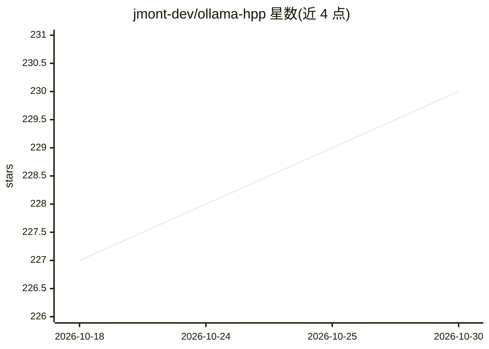

# jmont-dev/ollama-hpp

⭐ 230 · C++ · MIT · 推送 2026-04-25 · [GitHub](https://github.com/jmont-dev/ollama-hpp) · 个人维护

**C++ 单头文件库：封装 Ollama API，在 C++ 中调用本地模型**

面向 C++ 开发者的 header-only 绑定库，封装 Ollama 服务器 API（默认 localhost:11434）。只需包含单个头文件、无链接依赖，支持 C++11 至 C++26。功能覆盖 generate/chat（含流式与异步）、图像输入（vision 模型）、embedding 生成、模型拉取/删除/信息查询、从 GGUF 文件创建 blob。响应可表示为 nlohmann::json 或 std::string，支持可开关的异常处理。需本机运行 Ollama 服务器及对应模型。

## 筛选速览

| 维度 | 判定 | 备注 |
|---|---|---|
| AI 角色 | `ai-ecosystem` | LLM/agent 周边工具 |
| 许可风险 | `permissive` | MIT |
| 部署形态 | `None` |  |
| 模型依赖 | local-ok | 支持本地模型 |
| 硬件要求 | — | 无带数字的原话,不猜 |
| 安装摩擦 | `medium` | 含编译或系统依赖之一 |
| 成熟度 | — | 结构信号不足 |

## 能力要点

- 单头文件引入，支持 C++11-26，无链接依赖
- generate/chat 流式与异步流式生成，含回调与提前停止
- 图像 base64 编码输入，支持 llava 等 vision 模型
- 从 GGUF 文件创建 blob，自动计算 SHA256 并上传服务器

## 适用场景

- C++ 项目中调用本地 Ollama 模型做文本生成或对话
- 为 vision 模型发送图像并获取描述
- 在 C++ 程序里生成 embedding 或管理本地模型

## 场景标签

 · 领域:LLM 基础设施/开发库

## 证据(README 行号)

> L1: # ollama-hpp
> L2: Modern, Header-only C++11-26 bindings for the Ollama API.
> L18: Ensure you have an active instance of the ollama server and any models you plan to run. For more details, see https

## 星数曲线

2026-10-18 227 → 2026-10-30 230（+3）

---
*卡片 v1 · prompt 1.4 · 生成 2026-10-22 · 置信度 high · 依据 README sha `bc4e2157781a` · [字段定义](../../DATASET.md)*
