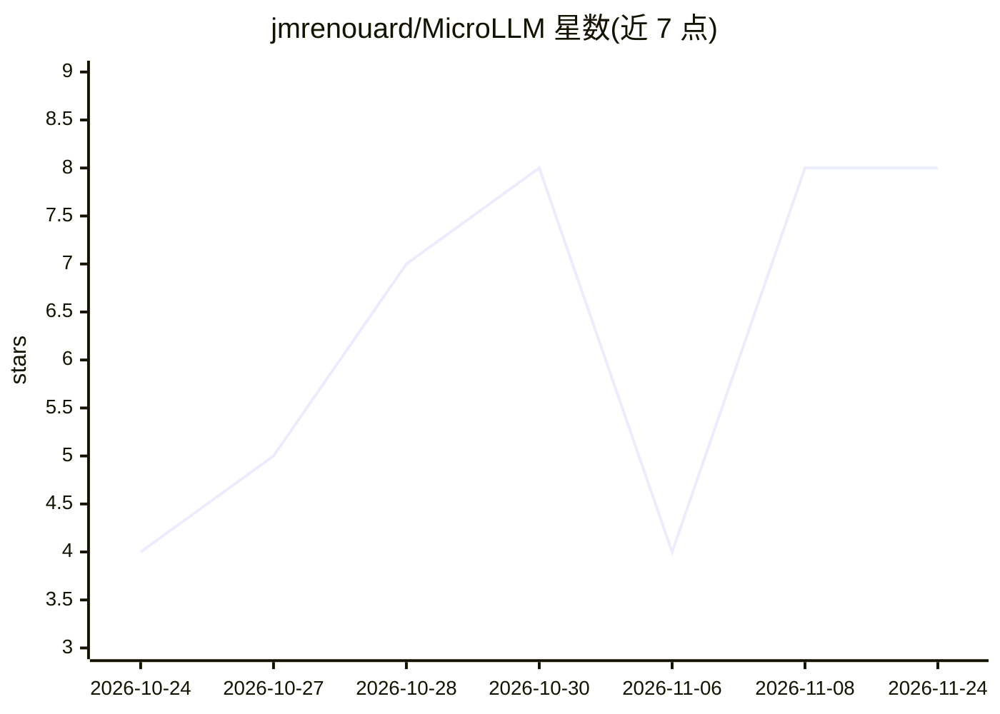

# jmrenouard/MicroLLM

⭐ 8 · Python · NOASSERTION · 推送 2026-11-22 · [GitHub](https://github.com/jmrenouard/MicroLLM) · 个人维护

**为 AI Agent 提供本地 CPU 低延迟校准决策引擎**

一个以 Python 包、Docker 镜像和 FastAPI/Gradio 服务形式发布的概率决策引擎，面向 Agent 管道中的结构化判断（意图路由、策略合规、严重度评分、注入过滤等），提供 noul/choice/score/multi 四种决策原语。核心机制包括 AnyJev L₀ 循环旋转平均消除选项顺序偏置、Split Conformal Prediction 输出 x_abstain 弃权信号、OpenJev-RLCD² 两阶段校准训练；以 INT8 ONNX 权重在 CPU 运行，README 称基准在单进程 CPU 测试机上完成。声明为三篇论文的 clean-room 实现。

## 筛选速览

| 维度 | 判定 | 备注 |
|---|---|---|
| AI 角色 | `ai-native` | 本体是模型或模型工具 |
| 许可风险 | `none` | NOASSERTION |
| 部署形态 | `self-host` | docker 或自建部署 |
| 模型依赖 | — | README 未给出锁定关系 |
| 硬件要求 | — | 无带数字的原话,不猜 |
| 安装摩擦 | `low` | 无编译、无系统依赖或容器化 |
| 成熟度 | — | 结构信号不足 |

## 能力要点

- 四种决策原语：noul（二元）、choice（互斥选择）、score（有序评分）、multi（多标签）
- Split Conformal Prediction 输出 x_abstain 认证弃权信号
- INT8 ONNX 权重在 CPU 运行，提供 microllm pull 拉取量化模型档位
- 一键复现 10 个基准套件（microllm benchmark --all-suites）

## 适用场景

- Agent 管道中替代调用大模型 API 做意图路由与布尔判断
- 对 prompt 注入、PII、幻觉做安全护栏检查
- 需要对分类决策附带弃权与校准置信度的场景
- 本地离线环境运行低内存占用的决策服务

## 场景标签

 · 领域:AI Agent/决策引擎

## 证据(README 行号)

> L19: > **Stop using generative System-2 models to make System-1 decisions:** use a calibrated probabilistic engine (`nou
> L115:     REQ["POST /v1/systemone state (str | JSON) noul · choice · score · multi"] --> G1
> L123: |**`choice`**|Mutually exclusive selection across `2..255` options|Returns `choice`, `probabilities`, renormalized

## 星数曲线

2026-10-24 4 → 2026-11-24 8（+4）

---
*卡片 v1 · prompt 1.4 · 生成 2026-11-20 · 置信度 high · 依据 README sha `fd11d621a86f` · [字段定义](../../DATASET.md)*
