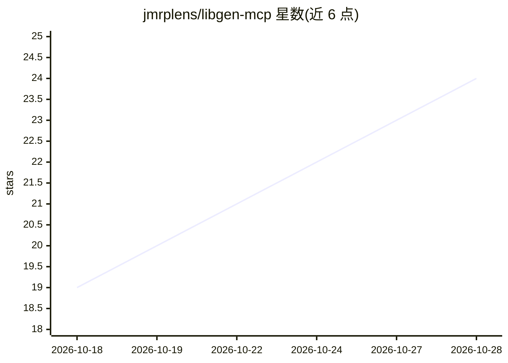

# jmrplens/libgen-mcp

⭐ 25 · Go · MIT · 推送 2026-10-26 · [GitHub](https://github.com/jmrplens/libgen-mcp) · [官网](https://docs.jmrp.io/libgen-mcp/) · 个人维护

**Go 编写的 MCP server：让 AI 助手检索、下载并阅读 Library Genesis 与开放获取文献**

面向 MCP 客户端（Claude、Cursor、VS Code 等）的 Model Context Protocol 服务器，用 Go 编写，以单一静态二进制或容器分发。提供四个工具：search（联合检索 Library Genesis 及 Anna's Archive、arXiv、OpenAlex、Crossref、PubMed 等 10 个无 key 数据源，去重并标注来源）、get_details（含 BibTeX/RIS 等 7 种引用格式与自由文本引文解析 DOI）、download、read（提取文本、分页、按章节阅读）。镜像自动发现与故障转移，四个工具约增加 6,800 token 上下文占用，无需账号或 API key。另有公共托管端点与 .mcpb 一键安装包。

## 筛选速览

| 维度 | 判定 | 备注 |
|---|---|---|
| AI 角色 | `ai-ecosystem` | LLM/agent 周边工具 |
| 许可风险 | `permissive` | MIT |
| 部署形态 | `self-host` | docker 或自建部署 |
| 模型依赖 | — | README 未给出锁定关系 |
| 硬件要求 | — | 无带数字的原话,不猜 |
| 安装摩擦 | `low` | 无编译、无系统依赖或容器化 |
| 成熟度 | — | 结构信号不足 |

## 能力要点

- search/get_details/download/read 四个聚焦工具加 4 个引导式 MCP prompt
- 目录无结果时自动回退到 10 个无 key 开放获取源，结果去重并标注来源
- get_details 输出 BibTeX/RIS 等 7 种引用格式，可将自由文本引文解析为 DOI
- read 工具无需完整下载即可提取文本、检索并按章节阅读

## 适用场景

- 在 Claude/Cursor 等 MCP 客户端中直接检索和下载图书与论文
- 让 AI 助手按 DOI 获取论文并总结某一章节
- 把粘贴的参考文献解析为 DOI 并生成多种格式引用

## 场景标签

`科研工具` · 领域:学习与行业

## 证据(README 行号)

> L17: **A Model Context Protocol (MCP) server, written in Go, for federated search, citation and reading of books, papers
> L12: libgen-mcp MCP server

## 星数曲线

2026-10-18 19 → 2026-10-28 24（+5）

---
*卡片 v1 · prompt 1.4 · 生成 2026-10-27 · 置信度 high · 依据 README sha `7b03637bb093` · [字段定义](../../DATASET.md)*
