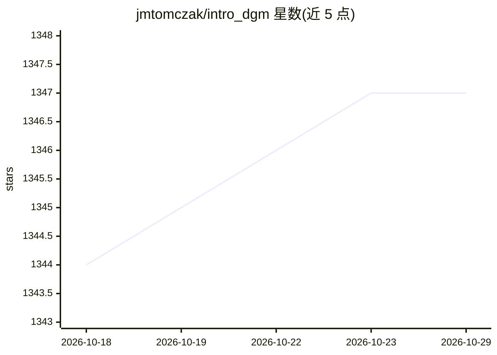

# jmtomczak/intro_dgm

⭐ 1,347 · Jupyter Notebook · MIT · 推送 2026-04-28 · [GitHub](https://github.com/jmtomczak/intro_dgm) · 个人维护

**深度生成模型教材配套的入门示例代码集（Jupyter notebooks）**

Jakub M. Tomczak 所著 Springer 书籍《Deep Generative Modeling》的配套代码仓库，提供 11 组 Jupyter notebook 入门示例，覆盖混合模型、自回归模型、流模型、VAE、扩散模型、score 模型、混合建模、EBM、GAN、神经压缩与一个名为 teenyGPT 的解码器式 transformer。示例设计为在普通笔记本上数分钟内可运行，面向学生、工程师与研究者；依赖 PyTorch 1.7.0 等库，另附教学用作业示例与课件图。使用时须引用书籍出处。

## 筛选速览

| 维度 | 判定 | 备注 |
|---|---|---|
| AI 角色 | `ai-knowledge` | 知识聚合/清单类 |
| 许可风险 | `permissive` | MIT |
| 部署形态 | `None` |  |
| 模型依赖 | — | README 未给出锁定关系 |
| 硬件要求 | — | 无带数字的原话,不猜 |
| 安装摩擦 | `low` | 无编译、无系统依赖或容器化 |
| 成熟度 | — | 结构信号不足 |

## 能力要点

- 11 类深度生成模型的入门 notebook 示例（ARM/流/VAE/扩散/EBM/GAN/LLM 等）
- 实验可在普通笔记本数分钟内运行
- 包含教学用作业示例与课件图（figures 目录）
- 要求引用配套书籍作为来源

## 适用场景

- 跟随《Deep Generative Modeling》书籍学习并动手运行各类生成模型
- 初学者逐行理解深度生成模型的实现
- 教师准备深度生成模型课程作业与课件

## 场景标签

`教程课程` · 领域:学习与行业

## 证据(README 行号)

> L3: Deep Generative Modeling
> L48: All examples of implemented deep generative models are provided as jupyter notebooks. They can be find in the follo

## 星数曲线

2026-10-18 1,344 → 2026-10-29 1,347（+3）

---
*卡片 v1 · prompt 1.4 · 生成 2026-10-21 · 置信度 high · 依据 README sha `5b4034107d40` · [字段定义](../../DATASET.md)*
