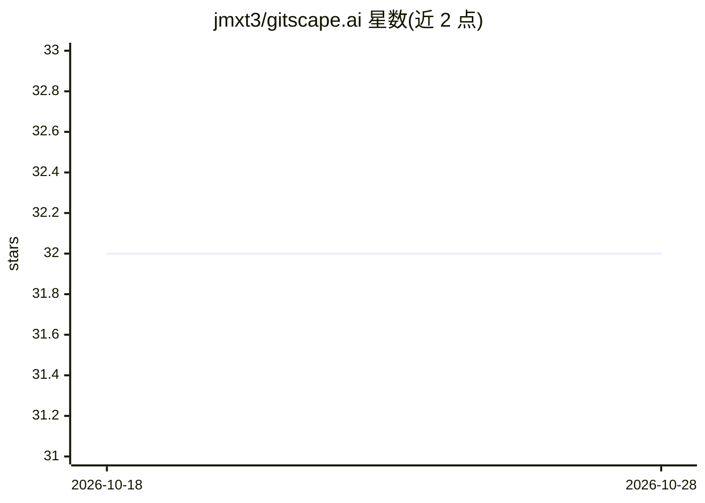

# jmxt3/gitscape.ai

⭐ 32 · Python · Apache-2.0 · 推送 2026-07-17 · [GitHub](https://github.com/jmxt3/gitscape.ai) · [官网](https://gitscape.ai) · 个人维护

**为 AI agent 编译代码库为技能并做安全扫描的工具**

GitScape 是一个开源平台、开发者工具与 MCP 服务器：将任意公开/私有 GitHub 仓库编译为渐进披露的 Agent Skill（SKILL.md + references/ 目录）与纯文本 Code Digest，以降低 AI 编程助手的 token 消耗；同时通过 ScapeGuard 静态分析引擎按 55+ 规则、9 类威胁（映射 OWASP Agentic/LLM Top 10）扫描技能包并给出 A–F 评级，Grade F 时阻断安装。提供零依赖 Node CLI（npx gitscape）、公共技能注册表（含 220+ NVIDIA CUDA 库索引）与交互式代码可视化。设计为无状态、无数据库，PAT 保存在本地浏览器。

## 筛选速览

| 维度 | 判定 | 备注 |
|---|---|---|
| AI 角色 | `ai-ecosystem` | LLM/agent 周边工具 |
| 许可风险 | `permissive` | Apache-2.0 |
| 部署形态 | `self-host` | docker 或自建部署 |
| 模型依赖 | — | README 未给出锁定关系 |
| 硬件要求 | — | 无带数字的原话,不猜 |
| 安装摩擦 | `low` | 无编译、无系统依赖或容器化 |
| 成熟度 | — | 结构信号不足 |

## 能力要点

- 将 GitHub 仓库编译为 Agent Skill 与 Code Digest（Tree-sitter 解析）
- ScapeGuard 按 55+ 规则、9 类威胁扫描并给出 A–F 评级，Grade F 阻断安装
- 内置 MCP 服务器与零依赖 Node CLI（npx gitscape）
- 含 220+ NVIDIA AI/CUDA 库的策展技能注册表

## 适用场景

- 把大型代码库压缩成省 token 的技能供 Cursor/Claude Code 使用
- 在安装 agent 技能前扫描提示注入、硬编码密钥与恶意执行
- 作为 CI/CD 门禁对仓库做安全审计（scan 命令非零退出）

## 场景标签

`网络安全` · 领域:学习与行业

## 证据(README 行号)

> L5:  The open-source repository compiler, security gate, and Model Context Protocol (MCP) server for AI agents.
> L31: **GitScape** is an open-source platform, developer tool, and Model Context Protocol (MCP) server that resolves the 
> L39: * 🔌 **Model Context Protocol (MCP)** — A built-in MCP server that exposes `install_skill` and `uninstall_skill` too

## 星数曲线

2026-10-18 32 → 2026-10-28 32（+0）

---
*卡片 v1 · prompt 1.4 · 生成 2026-10-26 · 置信度 high · 依据 README sha `a3bce610045a` · [字段定义](../../DATASET.md)*
