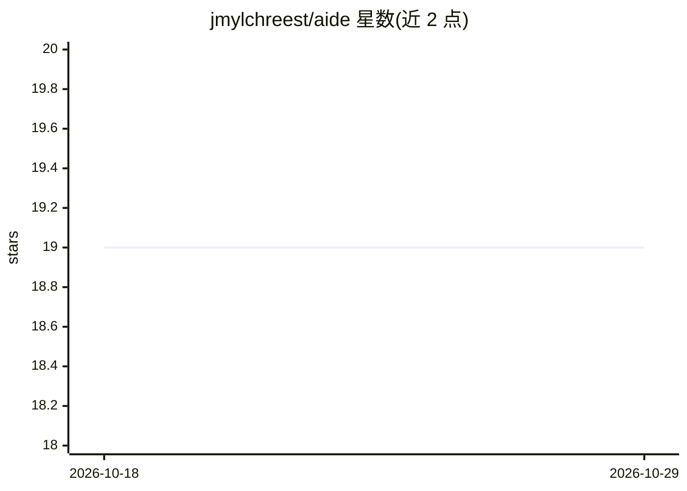

# jmylchreest/aide

⭐ 19 · Go · MIT · 推送 2026-10-26 · [GitHub](https://github.com/jmylchreest/aide) · [官网](https://jmylchreest.github.io/aide/) · 个人维护

**为 AI 编程助手提供持久记忆与多智能体编排的开发环境**

面向 Claude Code、OpenCode、Codex CLI 三款 AI 编程助手的环境增强层：提供跨会话持久记忆、架构决策记录、tree-sitter 代码索引（符号搜索/调用图）、静态分析、代码库测绘，以及 23 个自然语言触发的技能工作流和 swarm 并行多智能体 SDLC 流水线；通过 34 个 MCP 工具暴露能力。决策与记忆可导出为 git 友好的 markdown 供团队共享，未安装 AIDE 的助手也可读取。安装依赖 Bun 运行时，Go 二进制随 npm 包自动下载；另提供可选的 aide-web 监控面板（多平台二进制）。

## 筛选速览

| 维度 | 判定 | 备注 |
|---|---|---|
| AI 角色 | `ai-ecosystem` | LLM/agent 周边工具 |
| 许可风险 | `permissive` | MIT |
| 部署形态 | `desktop` | 安装包/桌面程序 |
| 模型依赖 | — | README 未给出锁定关系 |
| 硬件要求 | — | 无带数字的原话,不猜 |
| 安装摩擦 | `low` | 无编译、无系统依赖或容器化 |
| 成熟度 | — | 结构信号不足 |

## 能力要点

- 跨会话持久记忆与决策记录，可导出 markdown 供团队共享
- tree-sitter 代码索引：符号搜索、调用图、引用查找
- swarm 并行多智能体 SDLC 流水线（设计/测试/实现/验证/文档）
- 34 个 MCP 工具与 23 个内置技能，支持自然语言触发

## 适用场景

- 让 Claude Code/OpenCode/Codex CLI 记住我的偏好与架构决策
- 快速理解陌生代码库的结构与技术栈
- 团队通过 git 共享决策与记忆，保持 AI 助手上下文一致

## 场景标签

`多智能体` `Agent 记忆` · 领域:Agent 开发

## 证据(README 行号)

> L6: Persistent memory, code intelligence, and multi-agent orchestration for AI coding assistants. Works with **Claude Co
> L50: |**Swarm**|Parallel agents with full SDLC pipelines (design, test, implement, verify, docs)|

## 星数曲线

2026-10-18 19 → 2026-10-29 19（+0）

---
*卡片 v1 · prompt 1.4 · 生成 2026-10-28 · 置信度 high · 依据 README sha `acc2be096e66` · [字段定义](../../DATASET.md)*
