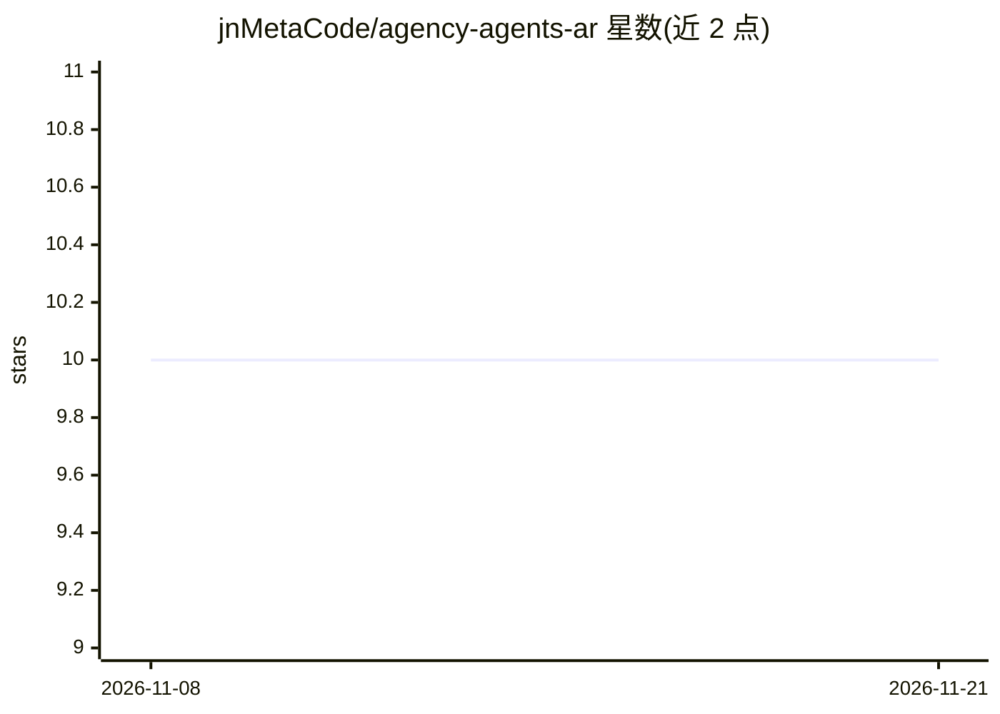

# jnMetaCode/agency-agents-ar

⭐ 10 · Shell · MIT · 推送 2026-07-23 · [GitHub](https://github.com/jnMetaCode/agency-agents-ar) · [官网](https://www.npmjs.com/package/agency-agents-ar) · 组织维护

**面向阿拉伯语用户的187个即用型AI代理人格库**

agency-agents 的阿拉伯语社区翻译版本：完整翻译上游184个AI代理人格，另含3个中东市场原创人格，覆盖工程、设计、营销、金融、游戏等18个分类。每个代理定义身份、工作流与交付物，支持通过安装脚本部署到17种AI编程工具，或作为npm包配合 Agency Orchestrator 运行。项目欢迎针对阿拉伯市场（Snapchat MENA、Noon、SAMA 合规等）的原创代理贡献。

## 筛选速览

| 维度 | 判定 | 备注 |
|---|---|---|
| AI 角色 | `ai-ecosystem` | LLM/agent 周边工具 |
| 许可风险 | `permissive` | MIT |
| 部署形态 | `library` | 以包/库形式分发 |
| 模型依赖 | — | README 未给出锁定关系 |
| 硬件要求 | — | 无带数字的原话,不猜 |
| 安装摩擦 | `medium` | 含编译或系统依赖之一 |
| 成熟度 | — | 结构信号不足 |

## 能力要点

- 187个即用型AI代理人格，覆盖18个专业分类
- 完整翻译上游184个代理，另含3个中东市场原创代理
- 提供安装脚本部署到17种AI编程工具，支持手动复制或作为npm包使用
- 可与 Agency Orchestrator 配合，以 DAG 工作流并行编排多个代理

## 适用场景

- 在 Claude Code 或 Cursor 中按需启用阿拉伯语的专业代理人格
- 为中东市场项目（电商、物流、金融合规）搭建AI代理团队
- 将多个代理组成团队完成 MVP 开发或安全审计流程

## 场景标签

`多智能体` `提示工程` · 领域:Agent 开发

## 证据(README 行号)

> L5: > **187 شخصية ذكاء اصطناعي جاهزة للاستخدام** — تغطي الهندسة، التصميم، التسويق، المنتج، الألعاب، الأمان، المالية، و 1
> L64: **مكتبة شخصيات ذكاء اصطناعي جاهزة للاستخدام**. كل وكيل له هوية واضحة، قواعد حرجة، سير عمل، ومخرجات محددة. ركّبها في

## 星数曲线

2026-11-08 10 → 2026-11-21 10（+0）

---
*卡片 v1 · prompt 1.4 · 生成 2026-11-19 · 置信度 high · 依据 README sha `31aa394b208c` · [字段定义](../../DATASET.md)*
