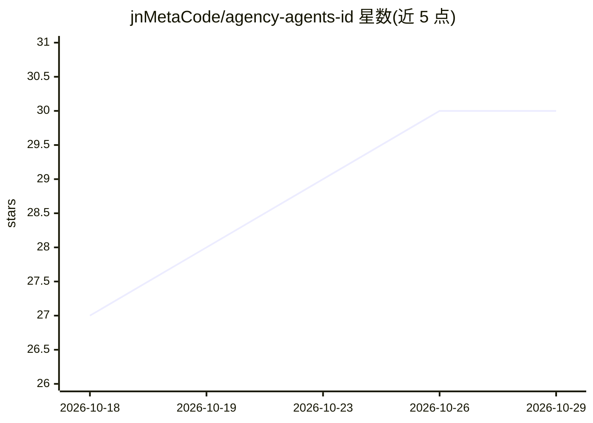

# jnMetaCode/agency-agents-id

⭐ 30 · Shell · MIT · 推送 2026-07-23 · [GitHub](https://github.com/jnMetaCode/agency-agents-id) · [官网](https://www.npmjs.com/package/agency-agents-id) · 个人维护

**187 个印尼语 AI agent 人格库，配 3 个印尼市场原创 agent**

agency-agents 上游 184 个 agent 的印尼语社区翻译版，另含 3 个针对印尼市场（Tokopedia/Gojek/WhatsApp Business）的原创人格，合计 187 个，按 18 个部门组织（Engineering 29、Marketing 30、Specialized 41、Game Dev 20 等）。每个人格定义身份、关键规则、工作流与交付物，非泛用 prompt 模板。支持 Claude Code/Cursor/Copilot 等 17 种 AI 编码工具，可通过安装脚本自动部署、手动复制 md 文件或作为 npm 包 agency-agents-id 供 Agency Orchestrator 调用；也可作为 prompt 参考直接查阅 CATALOG.md。

## 筛选速览

| 维度 | 判定 | 备注 |
|---|---|---|
| AI 角色 | `ai-knowledge` | 知识聚合/清单类 |
| 许可风险 | `permissive` | MIT |
| 部署形态 | `library` | 以包/库形式分发 |
| 模型依赖 | — | README 未给出锁定关系 |
| 硬件要求 | — | 无带数字的原话,不猜 |
| 安装摩擦 | `low` | 无编译、无系统依赖或容器化 |
| 成熟度 | — | 结构信号不足 |

## 能力要点

- 187 个 agent 人格（184 上游翻译 + 3 印尼市场原创）
- 定义 persona/工作流/交付物，非泛用 prompt 模板
- install.sh 支持自动检测并部署到 17 种 AI 编码工具
- 以 npm 包形式供 Agency Orchestrator 工作流引用

## 适用场景

- 为 Claude Code/Cursor 等编码工具安装各领域专家人格
- 组合多个人格组成虚拟团队执行 MVP 或安全审计流程
- 查阅 CATALOG.md 作为 prompt 编写参考
- 本地化场景：为印尼电商平台与支付渠道定制 agent（PR 参与）

## 场景标签

`提示工程` · 领域:Agent 开发

## 证据(README 行号)

> L5: > **187 persona AI agent yang siap pakai** — mencakup engineering, design, marketing, product, game, security, finan
> L68: Sebuah **library persona AI yang siap pakai**. Setiap agent punya identitas jelas, aturan kritis, workflow, dan del

## 星数曲线

2026-10-18 27 → 2026-10-29 30（+3）

---
*卡片 v1 · prompt 1.4 · 生成 2026-10-26 · 置信度 high · 依据 README sha `5b3c5a5a53b4` · [字段定义](../../DATASET.md)*
