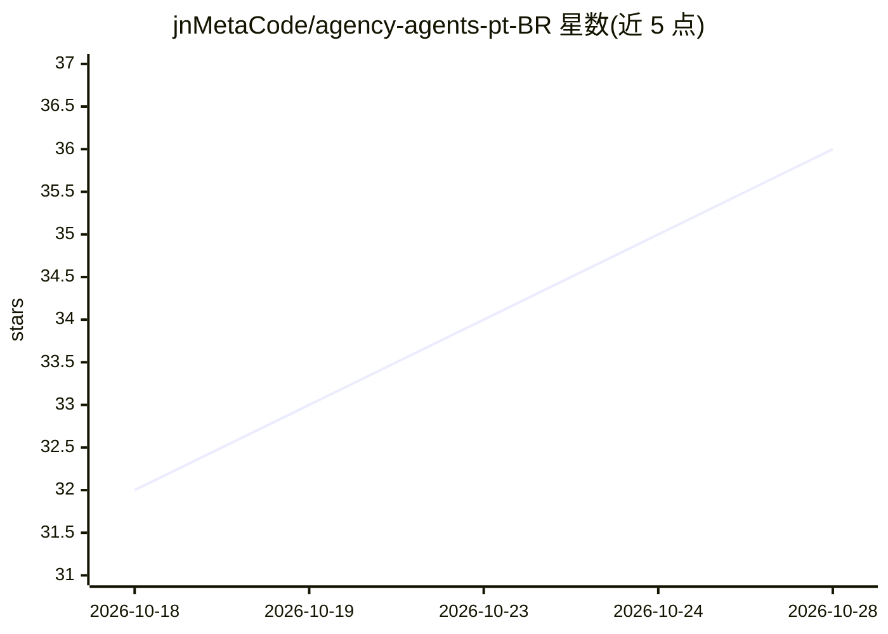

# jnMetaCode/agency-agents-pt-BR

⭐ 37 · Shell · MIT · 推送 2026-07-23 · [GitHub](https://github.com/jnMetaCode/agency-agents-pt-BR) · [官网](https://www.npmjs.com/package/agency-agents-pt-br) · 个人维护

**巴西葡萄牙语版 AI agent 人格库：187 个即用系统提示词**

agency-agents 的巴西社区版：将上游 184 个 agent 人格完整翻译为巴西葡萄牙语，另含 3 个巴西市场原创（PIX/Mercado Livre/WhatsApp Business）。每个人格定义身份、关键规则、工作流与交付物，覆盖工程、设计、营销、游戏等 18 个部门；支持 Claude Code、Cursor、Copilot 等 17 种 AI 编程工具，可通过 install.sh 自动安装或手动复制 Markdown 文件，也发布为 npm 包供 Agency Orchestrator 调用。邀请社区贡献更多巴西本地化 agent。

## 筛选速览

| 维度 | 判定 | 备注 |
|---|---|---|
| AI 角色 | `ai-knowledge` | 知识聚合/清单类 |
| 许可风险 | `permissive` | MIT |
| 部署形态 | `library` | 以包/库形式分发 |
| 模型依赖 | — | README 未给出锁定关系 |
| 硬件要求 | — | 无带数字的原话,不猜 |
| 安装摩擦 | `low` | 无编译、无系统依赖或容器化 |
| 成熟度 | — | 结构信号不足 |

## 能力要点

- 187 个 agent 人格（184 翻译 + 3 巴西原创），18 个部门分类
- 支持 17 种 AI 编程工具，提供自动安装脚本 install.sh
- 以 npm 包 agency-agents-pt-br 形式接入 Agency Orchestrator
- 招募巴西市场专属 agent（PIX、LGPD、iFood 等）贡献

## 适用场景

- 为 Claude Code / Cursor 等工具装上即用型专家人格
- 组建覆盖多职能的 AI agent 团队完成项目
- 查找巴西本地市场（支付/电商/合规）的 agent 提示词参考

## 场景标签

`提示工程` · 领域:Agent 开发

## 证据(README 行号)

> L5: > **187 personas de agentes de IA plug-and-play** — cobrindo engenharia, design, marketing, produto, jogos, seguranç
> L68: Uma **biblioteca de personas de IA pronta para uso**. Cada agente tem identidade clara, regras críticas, fluxo de t

## 星数曲线

2026-10-18 32 → 2026-10-28 36（+4）

---
*卡片 v1 · prompt 1.4 · 生成 2026-10-25 · 置信度 high · 依据 README sha `8ddb80540330` · [字段定义](../../DATASET.md)*
