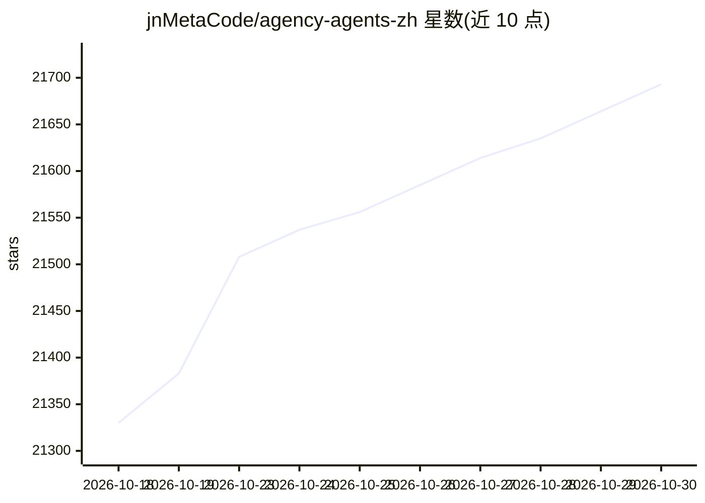

# jnMetaCode/agency-agents-zh

⭐ 21,693 · Shell · MIT · 推送 2026-10-27 · [GitHub](https://github.com/jnMetaCode/agency-agents-zh) · [官网](https://ao.aiolaola.com/experts) · 个人维护 · 中文 README

**328 个即插即用 AI 专家角色库，覆盖 22 个部门、支持 20 种工具**

AI 智能体角色定义的中文策展仓库：收录 328 个专家角色（261 个上游英文版翻译 + 67 个中国市场原创，如小红书/抖音/微信/飞书/钉钉运营、Qt 上位机、机械设计等），每个角色含独立人设、工作流程与交付物定义。提供 install.sh/convert.sh 脚本一键安装到 Claude Code、Copilot 等 20 种 AI 编程工具，可手动复制或作为提示词参考；配套编排器 agency-orchestrator（npm 安装）可按 DAG 让多专家协作，另有桌面客户端与在线浏览站点。

## 筛选速览

| 维度 | 判定 | 备注 |
|---|---|---|
| AI 角色 | `ai-knowledge` | 知识聚合/清单类 |
| 许可风险 | `permissive` | MIT |
| 部署形态 | `library` | 以包/库形式分发 |
| 模型依赖 | — | README 未给出锁定关系 |
| 硬件要求 | — | 无带数字的原话,不猜 |
| 安装摩擦 | `medium` | 含编译或系统依赖之一 |
| 成熟度 | — | 结构信号不足 |

## 动量与使用信号

- 维护:`active` — 距上次 push 0.9 天,年发版 6,16 位贡献者
- 涨星:近 1 天 **+24**(自 20261016 起算)
- 安装:npm 包 `agency-orchestrator` 月下载 3,507
- 平台:WINDOWS / MACOS / LINUX · 协议:MCP

## 能力要点

- 328 个角色定义，按工程/设计/营销等 22 个部门组织
- 67 个中国市场原创智能体（小红书/抖音/企微/飞书/钉钉等）
- install.sh 自动检测并一键安装到 20 种 AI 编程工具
- 配套 agency-orchestrator 编排器，一句话让多专家按 DAG 协作

## 适用场景

- 给我的 AI 编程工具装一批现成的专家角色，用自然语言激活
- 国内平台运营与垂直领域（工业上位机、机械设计等）找对应专家
- 通过编排器把多位专家组进同一工作流过同一个议题

## 场景标签

`多智能体` `提示工程` · 领域:Agent 开发

## 证据(README 行号)

> L5: > **328 个即插即用的 AI 专家角色** — 覆盖公司经营（CEO/CTO/CMO/COO/CPO/CFO）、工程、设计、营销、产品、游戏、安全、GIS、金融等 22 个部门。不是通用提示词模板，每个智能体都有独立的人设、专
> L110: 一套**开箱即用的 AI 角色库**。每个智能体都有明确的身份定义、关键规则、工作流程和交付物，安装到你的 AI 编程工具后用自然语言激活。
> L122: ./scripts/install.sh

## 星数曲线

2026-10-18 21,330 → 2026-10-30 21,693（+363）

---
*卡片 v1 · prompt 1.4 · 生成 2026-10-20 · 置信度 high · 依据 README sha `c260fab05ab0` · [字段定义](../../DATASET.md)*
