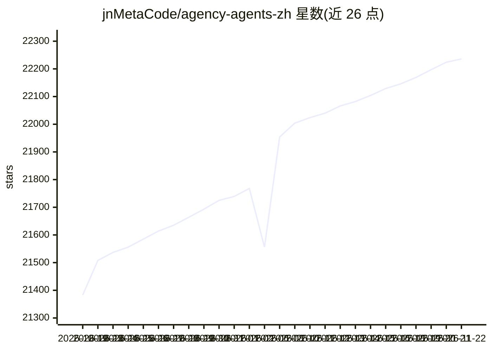

# jnMetaCode/agency-agents-zh

⭐ 22,236 · Shell · MIT · 推送 2026-11-18 · [GitHub](https://github.com/jnMetaCode/agency-agents-zh) · [官网](https://ao.aiolaola.com/experts) · 个人维护 · 中文 README

**面向 AI 编程工具的即插即用中文 AI 专家角色库**

上游 agency-agents 的中文社区版，收录 328 个 AI 专家角色定义（含 67 个中国市场原创），每个角色包含身份定义、关键规则、工作流程与交付物，可安装到 Claude Code、Cursor、Copilot 等 20 种 AI 编程工具后用自然语言激活。提供 install.sh 一键安装、convert.sh 格式转换、npm 包、手动复制与在线浏览五种获取方式；配套 agency-orchestrator 编排器支持多角色 DAG 协作，另有原生桌面客户端。

## 筛选速览

| 维度 | 判定 | 备注 |
|---|---|---|
| AI 角色 | `ai-knowledge` | 知识聚合/清单类 |
| 许可风险 | `permissive` | MIT |
| 部署形态 | `library` | 以包/库形式分发 |
| 模型依赖 | — | README 未给出锁定关系 |
| 硬件要求 | — | 无带数字的原话,不猜 |
| 安装摩擦 | `medium` | 含编译或系统依赖之一 |
| 成熟度 | — | 结构信号不足 |

## 动量与使用信号

- 维护:`active` — 距上次 push 0.9 天,年发版 6,16 位贡献者
- 涨星:近 1 天 **+24**(自 20261016 起算)
- 安装:npm 包 `agency-orchestrator` 月下载 3,507
- 平台:WINDOWS / MACOS / LINUX · 协议:MCP

## 能力要点

- 328 个角色覆盖 22 个部门，含 67 个中国市场原创智能体
- 支持 Claude Code / Cursor / Copilot 等 20 种 AI 编程工具
- 提供一键安装脚本、格式转换脚本与 npm 包多种获取途径
- 配套 agency-orchestrator 编排器实现多角色 DAG 并行协作

## 适用场景

- 为我的 AI 编程工具扩充中文领域的专家角色
- 在小红书、抖音、微信等国内平台的运营中获得专项建议
- 用编排器让多个专家角色自动组队完成一个任务

## 场景标签

`多智能体` `提示工程` · 领域:Agent 开发

## 证据(README 行号)

> L5: > **328 个即插即用的 AI 专家角色** — 覆盖公司经营（CEO/CTO/CMO/COO/CPO/CFO）、工程、设计、营销、产品、游戏、安全、GIS、金融等 22 个部门。不是通用提示词模板，每个智能体都有独立的人设、专
> L107: 一套**开箱即用的 AI 角色库**。每个智能体都有明确的身份定义、关键规则、工作流程和交付物，安装到你的 AI 编程工具后用自然语言激活。
> L109: **和普通提示词的区别**：普通提示词告诉 AI "你是一个专家"；这里的智能体定义了专家**怎么思考、怎么做事、交付什么**。例如安全工程师会按 OWASP Top 10 逐项审查代码，小红书运营专家会输出完整的种草笔记策略和

## 星数曲线

2026-10-19 21,383 → 2026-11-22 22,236（+853）

---
*卡片 v1 · prompt 1.4 · 生成 2026-11-22 · 置信度 high · 依据 README sha `536ba60f4230` · [字段定义](../../DATASET.md)*
