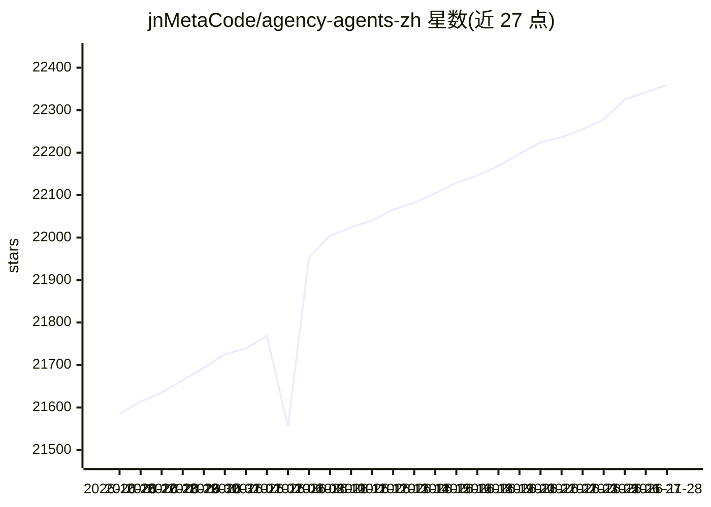

# jnMetaCode/agency-agents-zh

⭐ 22,359 · Shell · MIT · 推送 2026-11-26 · [GitHub](https://github.com/jnMetaCode/agency-agents-zh) · [官网](https://ao.aiolaola.com/experts) · 个人维护 · 中文 README

**给 AI 编程工具用户的即插即用专家角色库（328 个，22 部门）**

agency-agents 的中文社区版，提供 328 个智能体角色定义（261 个翻译自上游、67 个中国市场原创），每个角色包含身份人设、工作流程与可交付成果，覆盖公司经营、工程、设计、营销、金融等 22 个部门。角色以 Markdown 文件分发，可通过 install.sh 自动检测并安装到 20 种 AI 编程工具，或经 convert.sh 转为 OpenClaw 的 SOUL.md 格式，也可手动复制或 npm 获取；配套 agency-orchestrator 编排器支持多角色 DAG 协作。npm 包仅提供角色内容，不自动修改工具配置；非 Claude Code/Copilot 工具需先转换格式。

## 筛选速览

| 维度 | 判定 | 备注 |
|---|---|---|
| AI 角色 | `ai-knowledge` | 知识聚合/清单类 |
| 许可风险 | `permissive` | MIT |
| 部署形态 | `library` | 以包/库形式分发 |
| 模型依赖 | — | README 未给出锁定关系 |
| 硬件要求 | — | 无带数字的原话,不猜 |
| 安装摩擦 | `medium` | 含编译或系统依赖之一 |
| 成熟度 | — | 结构信号不足 |

## 动量与使用信号

- 维护:`active` — 距上次 push 0.9 天,年发版 6,16 位贡献者
- 涨星:近 1 天 **+24**(自 20261016 起算)
- 安装:npm 包 `agency-orchestrator` 月下载 3,507
- 平台:WINDOWS / MACOS / LINUX · 协议:MCP

## 能力要点

- 328 个智能体角色，每个含独立人设、专业流程与可交付成果
- 一条 install.sh 命令自动检测并安装到 20 种 AI 编程工具
- 67 个中国市场原创角色（小红书/抖音/微信/飞书/钉钉/Qt 上位机/机械设计等）
- 配套 agency-orchestrator 编排器：多专家按 DAG 自动协作，含桌面客户端

## 适用场景

- 给 Claude Code/Cursor 等工具安装领域专家角色辅助开发
- 让多位专家角色组队协作产出完整方案
- 查找小红书/抖音等国内平台运营的角色提示词参考

## 场景标签

`提示工程` `多智能体` · 领域:Agent 开发

## 证据(README 行号)

> L5: > **328 个即插即用的 AI 专家角色** — 覆盖公司经营（CEO/CTO/CMO/COO/CPO/CFO）、工程、设计、营销、产品、游戏、安全、GIS、金融等 22 个部门。不是通用提示词模板，每个智能体都有独立的人设、专
> L107: 一套**开箱即用的 AI 角色库**。每个智能体都有明确的身份定义、关键规则、工作流程和交付物，安装到你的 AI 编程工具后用自然语言激活。
> L124: > Claude Code 和 GitHub Copilot 可直接安装；其他工具需先运行 `./scripts/convert.sh` 转换格式。

## 星数曲线

2026-10-26 21,585 → 2026-11-28 22,359（+774）

---
*卡片 v1 · prompt 1.4 · 生成 2026-11-27 · 置信度 high · 依据 README sha `2880b3846041` · [字段定义](../../DATASET.md)*
