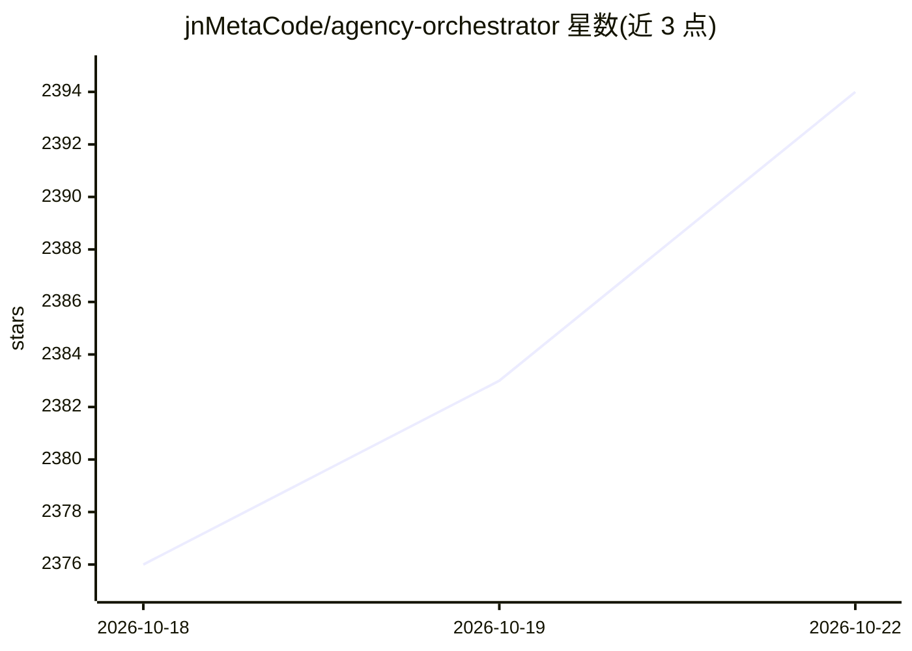

# jnMetaCode/agency-orchestrator

⭐ 2,397 · TypeScript · Apache-2.0 · 推送 2026-10-22 · [GitHub](https://github.com/jnMetaCode/agency-orchestrator) · [官网](https://ao.aiolaola.com) · 个人维护 · 中文 README

**多 AI 角色协作编排工具：一句话组队、几分钟交付方案**

以 YAML 零代码或一句话（ao compose）驱动多 AI 专家协作的工作流引擎：解析 YAML 构建 DAG，自动检测并行、传递变量、失败重试，输出到 ao-output/ 并可断点续跑、返工、导出 docx/pdf/xlsx/pptx。内置 276 个中文专业角色与 70 个工作流模板，支持 20+ 家 API（其中 10 种免 key 方式，如复用已登录的 Claude Code/Copilot/Codex 等 CLI 或本地 Ollama），另提供本地网页 Studio、Electron 桌面客户端与 Docker 镜像，可生成文生图/文生视频流水线并推送到钉钉/飞书/企微群。

## 筛选速览

| 维度 | 判定 | 备注 |
|---|---|---|
| AI 角色 | `ai-ecosystem` | LLM/agent 周边工具 |
| 许可风险 | `permissive` | Apache-2.0 |
| 部署形态 | `self-host` | docker 或自建部署 |
| 模型依赖 | local-ok | 支持本地模型 |
| 硬件要求 | — | 无带数字的原话,不猜 |
| 安装摩擦 | `low` | 无编译、无系统依赖或容器化 |
| 成熟度 | — | 结构信号不足 |

## 能力要点

- 276 个中文角色库 + 70 个内置工作流模板，一句话自动组队
- YAML 零代码编排，DAG 自动检测并行、失败重试、断点续跑
- 20+ 家 API 接入，含 10 种免 key 方式（复用已登录 CLI / 本地 Ollama）
- 网页 Studio / Electron 桌面端 / Docker 部署三种运行形态，产出可导出 docx/pdf/xlsx/pptx

## 适用场景

- 输入一句话让多个 AI 专家自动分工产出完整方案或商业计划
- 用 YAML 编排多角色工作流（如 PR 审查、方案到代码）接入脚本/CI
- 把 AO 的规划产出交给编程 Agent 执行，形成方案+代码流水线

## 场景标签

`多智能体` `Agent 框架` `工作流自动化` · 领域:Agent 开发

## 证据(README 行号)

> L203: 1. 解析 YAML → 构建 **DAG**（有向无环图）
> L110: ||ChatGPT / Claude|CrewAI / LangGraph|**Agency Orchestrator**|

## 星数曲线

2026-10-18 2,376 → 2026-10-22 2,394（+18）

---
*卡片 v1 · prompt 1.4 · 生成 2026-10-21 · 置信度 high · 依据 README sha `aa4d6c812366` · [字段定义](../../DATASET.md)*
