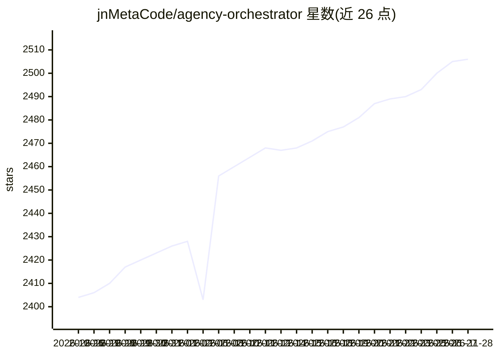

# jnMetaCode/agency-orchestrator

⭐ 2,506 · TypeScript · Apache-2.0 · 推送 2026-11-26 · [GitHub](https://github.com/jnMetaCode/agency-orchestrator) · [官网](https://ao.aiolaola.com) · 个人维护 · 中文 README

**一句话组队多 AI 专家自动协作，交付完整方案**

一个多智能体工作流编排工具：输入一句话自动拆解任务，从 276 个中文/184 个英文专业角色中匹配组队，按 DAG 并行执行并保存产物。以 YAML 定义工作流，零代码运行；支持 20+ 家 API 与 10 种免 key 方式（复用已登录的编码 CLI 或本地 Ollama），提供 `ao compose`/`ao run` 命令行、`ao web` 图形 Studio、Electron 桌面端与 Docker 部署。产物可导出 docx/pdf 等格式，支持断点续跑、带意见返工与 webhook 结果推送。面向个人创业者、开发者与内容创作者。

## 筛选速览

| 维度 | 判定 | 备注 |
|---|---|---|
| AI 角色 | `ai-ecosystem` | LLM/agent 周边工具 |
| 许可风险 | `permissive` | Apache-2.0 |
| 部署形态 | `self-host` | docker 或自建部署 |
| 模型依赖 | local-ok | 支持本地模型 |
| 硬件要求 | — | 无带数字的原话,不猜 |
| 安装摩擦 | `low` | 无编译、无系统依赖或容器化 |
| 成熟度 | — | 结构信号不足 |

## 能力要点

- 一句话自动从 276 个角色中组队并按 DAG 并行执行
- 20+ 家 API 接入，10 种免 key 方式（复用已登录 CLI / 本地 Ollama）
- `ao web` 图形 Studio：拖拽画布、可视化工作流编辑与分享报告页
- 70 个内置工作流模板，支持 `--resume` 续跑与 `--feedback` 返工

## 适用场景

- 输入一句创业想法，自动产出可行性分析或商业计划书
- 多角色协作完成深度长文或内容选题策划
- 方案到代码：PRD 喂给编码 Agent 并核对偏差
- 用 --notify 接 webhook 让 AI 团队定时交活

## 场景标签

`多智能体` · 领域:Agent 开发

## 证据(README 行号)

> L104: **Agency Orchestrator = 让多个 AI 专家各干各的，最后汇总。相当于一个人 vs 一个团队。**
> L121: npm install -g agency-orchestrator
> L214: > 统计口径（以源码为准）：**免 key** = 复用已登录订阅的 9 个编码 CLI（Claude Code / Antigravity / Copilot / Codex / OpenClaw / Hermes / Cod

## 星数曲线

2026-10-26 2,404 → 2026-11-28 2,506（+102）

---
*卡片 v1 · prompt 1.4 · 生成 2026-11-27 · 置信度 high · 依据 README sha `3740d0f2f5b8` · [字段定义](../../DATASET.md)*
