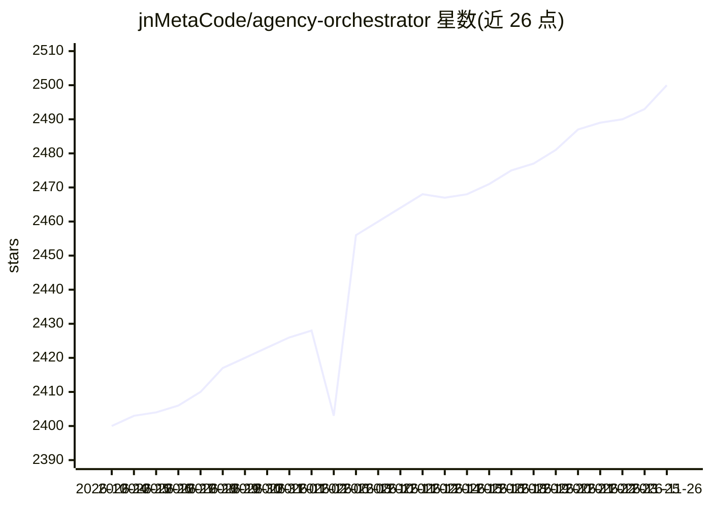

# jnMetaCode/agency-orchestrator

⭐ 2,500 · TypeScript · Apache-2.0 · 推送 2026-11-23 · [GitHub](https://github.com/jnMetaCode/agency-orchestrator) · [官网](https://ao.aiolaola.com) · 个人维护 · 中文 README

**零代码多智能体编排工具：一句话组建 AI 专家团队出方案**

npm 安装的 CLI 与网页/桌面 Studio，让多个 AI 角色按 DAG 自动分工协作。输入一句话自动拆解任务、从 276 个中文角色（184 英文角色）中匹配并生成工作流 YAML；支持 20+ 家模型接入（含 10 种免 key 方式，复用已登录编码 CLI 或本地 Ollama）、70 个内置模板、--resume 断点续跑与 --feedback 返工、验收标准自动核验、结果推送钉钉/飞书/企业微信，可经 --export 导出 docx/pdf/xlsx/pptx 等交付物。

## 筛选速览

| 维度 | 判定 | 备注 |
|---|---|---|
| AI 角色 | `ai-ecosystem` | LLM/agent 周边工具 |
| 许可风险 | `permissive` | Apache-2.0 |
| 部署形态 | `self-host` | docker 或自建部署 |
| 模型依赖 | local-ok | 支持本地模型 |
| 硬件要求 | — | 无带数字的原话,不猜 |
| 安装摩擦 | `low` | 无编译、无系统依赖或容器化 |
| 成熟度 | — | 结构信号不足 |

## 能力要点

- 一句话自动组队：AI 从 276 个角色中匹配并生成 DAG 工作流 YAML
- 20+ 家 API 接入，10 种免 key 方式（复用 Claude Code 等 9 个已登录 CLI + 本地 Ollama）
- 网页 Studio 可视化画布拖拽编辑工作流，桌面客户端（Electron）三平台可用
- 支持 --resume 断点恢复、--feedback 带意见返工、验收标准（acceptance）核验

## 适用场景

- 一句话生成创业可行性分析、商业计划书等多角色评审方案
- 方案到代码流水线：PRD 喂给编码 Agent 并按「不做清单」核对偏差
- 用内置模板跑 PR 代码审查、深度长文写作等固定流程
- 配合 cron 让 AI 团队每天定点把结果推送到钉钉/飞书/企业微信

## 场景标签

`多智能体` `工作流自动化` `代码审查` `编码 Agent` · 领域:Agent 开发

## 证据(README 行号)

> L104: **Agency Orchestrator = 让多个 AI 专家各干各的，最后汇总。相当于一个人 vs 一个团队。**
> L199: 1. 解析 YAML → 构建 **DAG**（有向无环图）
> L214: > 统计口径（以源码为准）：**免 key** = 复用已登录订阅的 9 个编码 CLI（Claude Code / Antigravity / Copilot / Codex / OpenClaw / Hermes / Cod

## 星数曲线

2026-10-24 2,400 → 2026-11-26 2,500（+100）

---
*卡片 v1 · prompt 1.4 · 生成 2026-11-24 · 置信度 high · 依据 README sha `d36379845352` · [字段定义](../../DATASET.md)*
