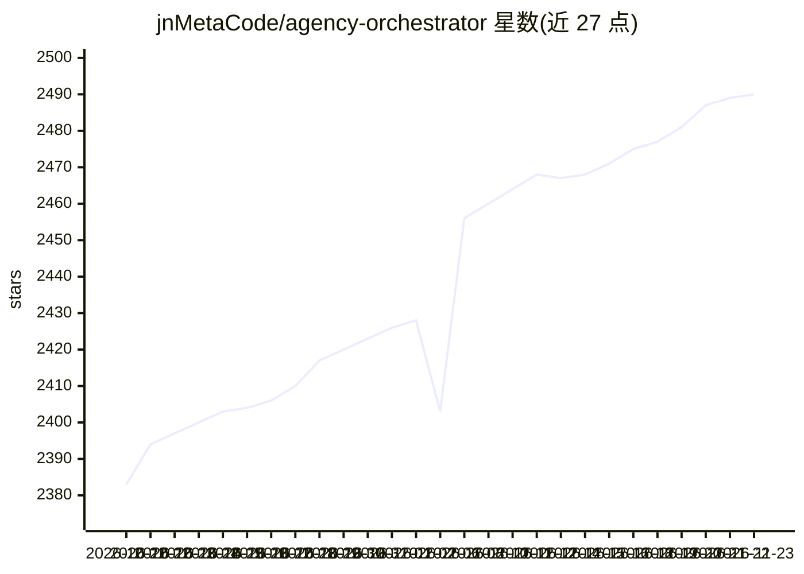

# jnMetaCode/agency-orchestrator

⭐ 2,490 · TypeScript · Apache-2.0 · 推送 2026-11-11 · [GitHub](https://github.com/jnMetaCode/agency-orchestrator) · [官网](https://ao.aiolaola.com) · 个人维护 · 中文 README

**一句话组建多 AI 角色协作团队，自动交付完整方案**

一个多智能体编排 CLI 与图形工具：用户输入一句话或编写 YAML 工作流，引擎从 276 个中文/184 个英文角色库中匹配角色，构建 DAG 并行执行，步骤间通过变量传递输出，产物保存到 ao-output/ 并支持 --resume/--feedback 返工与 docx/pdf 等导出。提供 Web Studio（ao web）、Electron 桌面端与 Docker 部署三种形态。运行依赖外部 LLM：支持 20+ 家 API 与 10 种免 key 方式（复用已登录的编码 CLI 或本地 Ollama）。npm 安装，2 个依赖。

## 筛选速览

| 维度 | 判定 | 备注 |
|---|---|---|
| AI 角色 | `ai-ecosystem` | LLM/agent 周边工具 |
| 许可风险 | `permissive` | Apache-2.0 |
| 部署形态 | `self-host` | docker 或自建部署 |
| 模型依赖 | local-ok | 支持本地模型 |
| 硬件要求 | — | 无带数字的原话,不猜 |
| 安装摩擦 | `low` | 无编译、无系统依赖或容器化 |
| 成熟度 | — | 结构信号不足 |

## 能力要点

- 一句话自动拆解任务、从 276 个角色中组队并按 DAG 并行执行
- 20+ 家 API 供应商与 10 种免 key 运行方式（复用已登录编码 CLI/本地 Ollama）
- Web Studio 可视化画布编辑工作流，含 70 个内置模板
- 结果推送钉钉/飞书/企业微信 webhook，支持分享报告页

## 适用场景

- 一句话生成创业可行性分析、商业计划书等多视角方案
- 用 YAML 定义多角色工作流并行执行内容生产任务
- 方案到代码：PRD 喂给编码 agent 并对照不做清单查偏差
- 免 API key 用已有 Claude/Copilot 订阅跑多智能体任务

## 场景标签

`多智能体` `工作流自动化` · 领域:Agent 开发

## 证据(README 行号)

> L83: **不用写代码，不用写配置，不用选角色。** 一句话 → AI 自动拆解任务 → 从 276 个角色中匹配 → 按 DAG 并行执行 → 输出完整方案。
> L197: 1. 解析 YAML → 构建 **DAG**（有向无环图）
> L212: > 统计口径（以源码为准）：**免 key** = 复用已登录订阅的 9 个编码 CLI（Claude Code / Antigravity / Copilot / Codex / OpenClaw / Hermes / Cod

## 星数曲线

2026-10-21 2,383 → 2026-11-23 2,490（+107）

---
*卡片 v1 · prompt 1.4 · 生成 2026-11-23 · 置信度 high · 依据 README sha `16419e7b0f54` · [字段定义](../../DATASET.md)*
