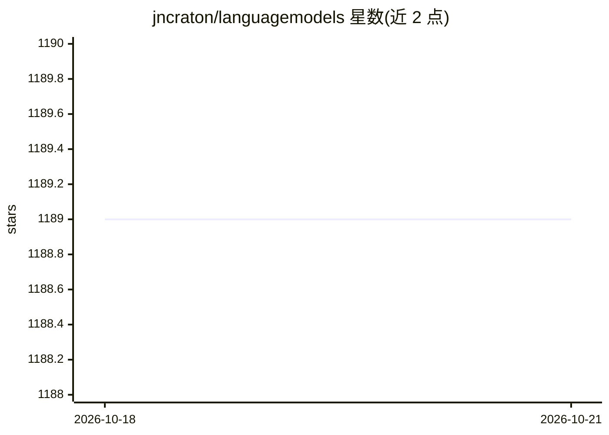

# jncraton/languagemodels

⭐ 1,189 · HTML · MIT · 推送 2026-02-19 · [GitHub](https://github.com/jncraton/languagemodels) · [官网](https://jncraton.github.io/languagemodels/) · 个人维护

**在 512MB 内存内本地运行大语言模型的 Python 库**

面向学习者和教育者的 Python 库，以极简 API（lm.do/complete 等）在本地执行大语言模型推理，默认数据不出本机。基于 CTranslate2 后端与 int8 量化实现低内存 CPU 推理，按 max_ram 配置（0.5-10GB）自动选择 gemma-3-270m 至 Llama-3.1-8B 等默认模型，支持 NVIDIA GPU 加速、语义搜索、维基检索辅助。首次运行需下载约 250MB 模型；默认模型规模远小于当前主流模型。包本身允许商用，但所用模型许可需自行用 require_model_license 过滤。

## 筛选速览

| 维度 | 判定 | 备注 |
|---|---|---|
| AI 角色 | `ai-native` | 本体是模型或模型工具 |
| 许可风险 | `permissive` | MIT |
| 部署形态 | `library` | 以包/库形式分发 |
| 模型依赖 | — | README 未给出锁定关系 |
| 硬件要求 | — | 无带数字的原话,不猜 |
| 安装摩擦 | `medium` | 含编译或系统依赖之一 |
| 成熟度 | — | 结构信号不足 |

## 能力要点

- lm.do/complete 等极简 API，本地推理保护数据隐私
- CTranslate2 + int8 量化实现 512MB 内存内 CPU 推理
- 按 max_ram 自动选择模型（0.27B~8B），可选 CUDA GPU 加速
- 内置语义搜索、维基/日期检索等上下文增强辅助函数

## 适用场景

- 在低配电脑或 REPL/Notebook 中体验和学习大语言模型
- 教学项目中快速搭建 CLI/Streamlit 聊天机器人
- 做文本分类、抽取式问答与文档语义搜索实验

## 场景标签

`推理引擎` `语义搜索` · 领域:知识与检索

## 证据(README 行号)

> L9: Python building blocks to explore large language models in as little as 512MB of RAM
> L13: This package makes using large language models from Python as simple as possible. All inference is performed locall
> L27: >>> lm.do("What color is the sky?")

## 星数曲线

2026-10-18 1,189 → 2026-10-21 1,189（+0）

---
*卡片 v1 · prompt 1.4 · 生成 2026-10-21 · 置信度 high · 依据 README sha `091883b54183` · [字段定义](../../DATASET.md)*
