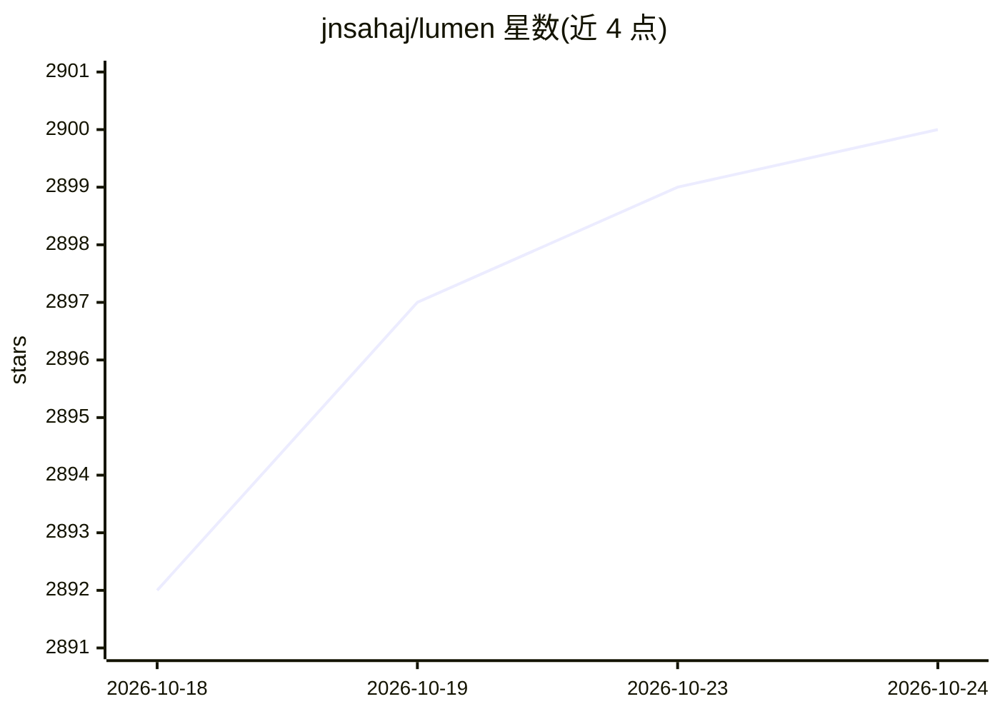

# jnsahaj/lumen

⭐ 2,900 · Rust · MIT · 推送 2026-09-17 · [GitHub](https://github.com/jnsahaj/lumen) · 个人维护

**终端并排 diff 查看器，附带可选 AI 提交信息与变更解释**

用 Rust 编写的终端 diff 查看与代码审查 TUI，以单一静态二进制分发。核心功能：并排 diff 展示（tree-sitter 语法高亮）、审查 GitHub PR、堆叠提交浏览、三级注释（选区/hunk/文件）、watch 模式与多主题，兼容 Git 与 Jujutsu。可选 AI 功能：生成提交信息、自然语言生成 git 命令（执行前确认）、变更解释，支持 10+ 提供商（OpenAI/Claude/Gemini/Ollama 等）。另提供编码 agent 集成，可将注释经 stdout 回传给 agent。AI 需配置提供商方可使用，diff 查看器本身不依赖 AI。

## 筛选速览

| 维度 | 判定 | 备注 |
|---|---|---|
| AI 角色 | `ai-enhanced` | 去掉 AI 部分产品仍成立 |
| 许可风险 | `permissive` | MIT |
| 部署形态 | `library` | 以包/库形式分发 |
| 模型依赖 | local-ok | 支持本地模型 |
| 硬件要求 | — | 无带数字的原话,不猜 |
| 安装摩擦 | `low` | 无编译、无系统依赖或容器化 |
| 成熟度 | — | 结构信号不足 |

## 能力要点

- 并排 diff 查看器含 tree-sitter 语法高亮与多主题
- 可选 AI 提交信息生成、自然语言 git 命令与变更解释（10+ 提供商）
- GitHub PR 审查与堆叠提交浏览
- 通过 stdin/stdout 与编码 agent 集成，回传注释作为下一轮 prompt

## 适用场景

- 在终端里并排审查 diff、提交或 GitHub PR
- 让 AI 根据暂存变更生成提交信息或解释改动
- 在编码 agent 工作流中给 diff 加注释并回传给 agent

## 场景标签

`代码审查` · 领域:编码与开发

## 证据(README 行号)

> L12: Review `git diff`, commits, branches, or GitHub PRs side-by-side without leaving your terminal. Ships as a single s
> L130: ## AI Features 🔅
> L132: Lumen also bundles optional AI helpers for commit messages, explanations, and natural-language git commands. These

## 星数曲线

2026-10-18 2,892 → 2026-10-24 2,900（+8）

---
*卡片 v1 · prompt 1.4 · 生成 2026-10-21 · 置信度 high · 依据 README sha `60f0f8607360` · [字段定义](../../DATASET.md)*
